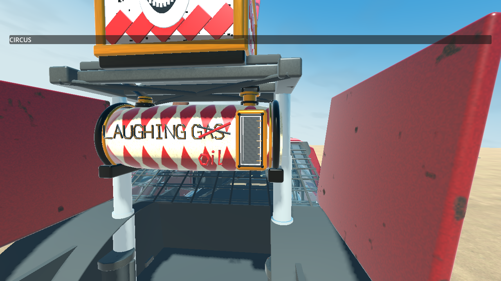
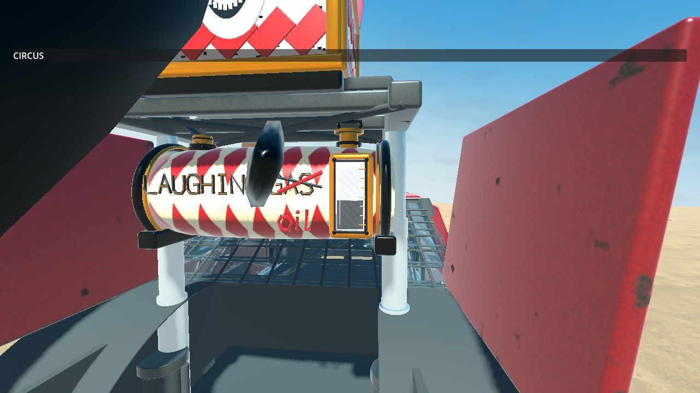
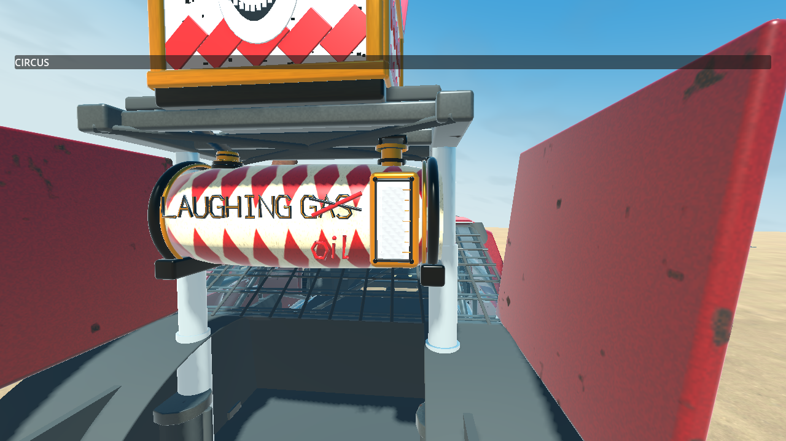

# TS-245 Round 5 runtime evidence

These are native Godot 4.7.2 Compatibility captures on a GTX 1070, with local UDP peers. They are automated scenario evidence and direct image observation, not human playtesting or acceptance. The report is [TS-245 verification](../../ts-245.md#approved-additional-story-round-5--2026-10-13).

## Grass entry and hard drift

- `grass-bank-0.webp`, `grass-bank-1.webp`, `grass-bank-2.webp`: chronological production-oval motion for two grass-to-bank burst timings and an airborne start. Full steering/handbrake reached 179.72 degrees. Each animation preserves simulation-frame spacing, not wall-clock video timing.
- `grass-bank-*-firing.png` and `grass-bank-*-deposits.png`: final rendered burst and deposited footprints. `grass-bank-trace.json`, `grass-bank-evidence.txt` and `grass-bank-runtime.log` retain native state and results. Every deposited segment's center and 64 rendered perimeter vertices were checked against actual static support.
- `proxy-before-bank.png` and its trace: initial pre-fix diagnostic starting **on** the bank, before the user clarified the grass approach. It found five unsupported car-proxy deposits. This is diagnostic evidence, not a functional pass or the later specified maneuver.
- `grass-before-streak.png`, its trace and `grass-before-streak-fix.log`: the revised grass approach before the capsule-bound correction. It reached 179.99 degrees and failed on one unsupported streak. This distinguishes the two defects rather than claiming one fix resolved everything.

## Integrated weapon

`deployment-straight.webp`, `airborne.webp`, `replacement.webp`, individual PNGs, `trace.json`, `evidence.txt` and `runtime.log` cover the native full lifecycle run. `recordings.json` identifies original frame numbers and SHA-256 hashes. `runtime-summary.json` reports process-interval/resource observations, including their limitations. The camera/readback workload is not a performance benchmark.

`meter-full.png`, `meter-half.png` and `meter-empty.png` show the actual imported sight glass against the fixed ivory backing. Readback levels are printed in the native log. The hoses and stepped brass fittings use the same runtime model; no reference-image pixels were copied into gameplay.

| Full (1.000) | Draining (0.442) | Empty (0.000) |
| --- | --- | --- |
|  |  |  |

`check-final.log`, `core-deposition.log` and `asset-validation.json` retain the repository gate, support/coverage tests and source/export/hash comparison. Other named native logs record contacts, handling, rack handoffs, recovery and Oil developer options. Any failures are retained and described in the report; a log's existence alone does not establish a pass.

All images are actual runtime captures. Reference concepts remain external user/Jira assets. No generated replacement imagery is presented as runtime evidence.

## Independent Astra critique

[Formal Round 5 critique](astra-round-5.md): **7.9/10 — FAIL (<8.0)**. Separate fresh native presentation and grass-to-bank runs passed. Files prefixed `astra-*` retain the reviewer's logs, traces, direct captures and 51 selected chronological frames, with source hashes. Its partial meter image shows 0.268 remaining; the primary full-run image above shows 0.442. Neither filename `half` asserts an exact 50% reading. The critique records remaining stream/splash presentation findings and unverified behavior. No further polish followed the assessment.
