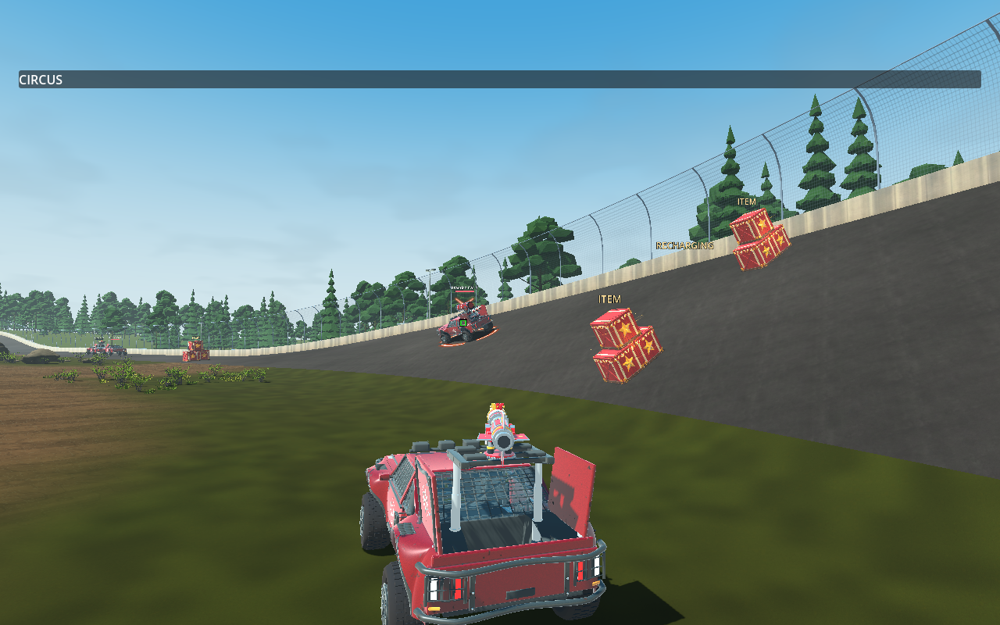
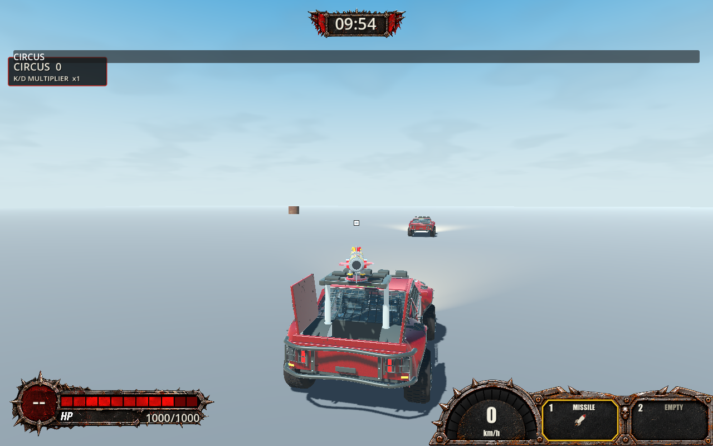
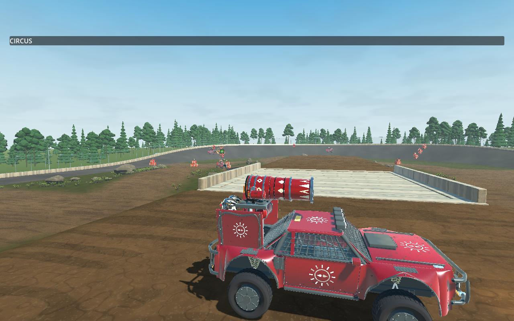

# TS-305 — Magnetic acquisition, retention and persistent cursor

Latest result: controller polish Round 2 (2026-10-30), below. The original implementation and Round 1 critique are retained as historical evidence.

Date: 2026-10-29. Branch: `ts-305-pg`. Base: `b55d5b388f52142e3b71f53787923f73e5ea1b29` (local main and freshly fetched origin/main matched before final verification).

Scope was checked against [TS-305](https://jonathangenier.atlassian.net/browse/TS-305), [TS-302](https://jonathangenier.atlassian.net/browse/TS-302), repository instructions and the explicit implementation request. TS-305 has no required children. Detailed switching/manual-leading polish remains TS-306; weapon-by-weapon redesign remains outside this Story.

## Implemented

- Added a local angular magnetic cursor, separate from camera rotation. Attraction ramps in progressively; retained rendered target motion keeps the cursor focused without target-driven camera following.
- Small opposing movements are absorbed. Sustained directional mouse/controller input progressively reduces retention, with independent thresholds/ramp rates and a physical-input floor at low sensitivity. Release preserves cursor position, then eases its offset toward ordinary free aim. Existing eligibility, occlusion, timeout and dismissal rules remain in use.
- Kept the square visible during acquisition/retention, green while retained, alongside the separate target indicator. White/red readiness presentation resumes outside retention.
- Removed the hidden body-center desired-shot override. The visible cursor ray supplies aim intent during acquisition, retention and departure. Host articulation, readiness and clearance still constrain accepted firing; the square is not an impact guarantee. No automatic leading or post-launch homing was added.
- Left weapon rules, projectile continuation, multiplayer authority, TS-304 camera implementation/settings and version files unchanged.
- Updated feature documentation, deterministic cursor tests, native assertions and fast-check routing. Added `check-weapon-aim.ps1 -Magnetic` for gradual left/right departure, continuous visibility, submitted-ray agreement and real Missile use at 35/200 m with both input paths.
- Corrected verification fixtures: compare actual cursor rather than old screen center; replenish each driving comparison's magazine; generate aim input from visible cursor; wait for actual Missile deployment; align death-probe victim with the measured straight-launch path. These do not alter production weapons.

## Commands and results

All Godot runs used the pinned .NET editor at `.godot/godot-ci/4.7.2/Godot_v4.7.2-stable_mono_win64/Godot_v4.7.2-stable_mono_win64_console.exe` (`$g` below). Native checks used Windows, actual collision worlds and local native UDP peers. Elevated execution was needed for Godot user data/certificate access. No auditing or verification gate was disabled.

| Command | Actual result |
| --- | --- |
| `./tools/check-fast.ps1 -Area Transport -OutputDirectory .godot/ts-305/targeted` | PASS, 494 non-native transport/client tests during iteration. |
| `./check.ps1` | PASS: Debug production and Release solution builds, zero warnings/errors; 1,518 Core + 494 non-native transport/client tests. Version-rule regression fixtures: 108 checks; workflow/agent-tooling/media checks passed (217 agent-tooling assertions). Expected negative tooling fixtures are not repository failures. |
| `./check-weapon-aim.ps1 -GodotPath $g -Magnetic -Visual -Impaired` | PASS, 50 checks: mouse/controller left/right departure at 35/200 m, square present throughout sampled movement, bounded sample displacement, visible movement before release, submitted visible-ray agreement and eight actual Missile launches. Impairment: 30 ms outbound latency, 5 ms jitter, 2% loss. |
| `./check-weapon-aim.ps1 -GodotPath $g -NoBuild -Visual` | PASS, 1,231 integrated checks across three native UDP peers: real Machine Gun use/damage/presentation, side/rear/elevated aim, moving targets, retention/occlusion/blackout, input/focus/lifecycle, camera preferences, airborne/landing/high-speed behavior and real Missile death/respawn. |
| `./check-weapon-aim.ps1 -GodotPath $g -Freedom -Impaired` | PASS, 41 checks. Assisted driving retained 180/180 visible samples and hit 240/240 fixture rays; comparable unassisted run hit 54/240. Native flight retained 140/140 airborne and 99/99 grounded samples. Scripted evidence, not a general accuracy promise. |
| `./check-camera.ps1 -GodotPath $g -NoBuild` | PASS: shared framing, 30/60/144 FPS, 81 framing combinations, 36 look combinations, nine FOV/height bounds, 18 tactical cases, orbit/recenter, suppression and lifecycle regressions. |
| `./check-hosted-practice.ps1 -GodotPath $g -NoBuild -Aim -Visual` | PASS: all four TS-303 practice cars, moving/parked targets, acquisition/lock markers and remote Missile launches on the actual map. |
| `& $g --headless --path . --quit-after 120` | PASS, exit 0; no ERROR/WARNING output. |
| `./tools/check-version.ps1` | FAIL: expected `0.2.70`, actual/main `0.2.69`. Explicit user instruction forbids version changes; this remains a delivery/CI gate limitation. |

The final integrated runtime suite was rerun after the death-fixture correction. After the comprehensive deterministic gate, the magnetic fixture was adjusted to hold its 200 m case above intervening prototype geometry; its fresh Debug warnings-as-errors build and complete rendered impaired run passed. Production code was unchanged during these final checks.

Ignored local logs: `.godot/ts-305/check.log`, `magnetic-final.log`, `full-aim-final.log`, `freedom.log`, `camera-final.log`, `practice-final.log`, `startup.log`, `version.log`. Full aiming artifacts: `.godot/aim-checks/0eb4874ce0034d109892535427985169`; magnetic: `.godot/aim-checks/31afe47c70fa4eec9f9ce6cca5e75289`; camera: `.godot/camera-checks/a34ab8be1ac949d4bde34ff6e24fdb20`.

## Runtime evidence and limitations

**VERIFIED:** Scripted input-adapter events, rendered snapshots, native collision/fire and local multiplayer execution. Moving-target checks measured zero target-driven camera drift. Camera preference coverage includes 164 cases with authoritative clearance and observer-camera isolation. The square is visible and green on the practice-bank target, with separate target art; after deliberate departure it is visible away from the car and the submitted ray follows it.

**INFERRED:** The release foundation supports manual leading on the bank. Isolated departure fixtures establish continuous release and truthful aim, but do not prove a successful one-car-length human-led hit on that moving target.

**UNVERIFIED:** Hands-on mouse feel, physical-controller ergonomics/drift, the exact tabletop/left-bank one-car-length lead scenario, Internet/multi-device multiplayer, extended soak and audio. Computer-use window capture timed out twice; no hands-on playtest is claimed. Synthetic controller events traverse the production adapter but are not a physical device. The 200 m fixture holds cars above prototype walls to isolate input/LOS; the practice-map run separately exercises real terrain.

Earlier attempts exposed stale centered-cursor assertions, shared/depleted ammunition and an unaligned damage fixture; these were corrected and the full baseline passed. A full rendered impaired run intermittently failed the existing close-side Machine Gun barrel-presentation assertion. Focused impaired freedom/magnetic runs passed, but a complete impaired-suite pass is **not** claimed. Headless full-suite attempts cannot provide rendered pre-draw muzzle samples; the successful full run used `-Visual`.

The hidden center correction is intentionally removed: shots follow visible intent subject to normal weapon constraints. Fine switching/lead placement may need human-directed TS-306 tuning. No physics, Core serialization, firing authority, projectile implementation, dependency or third-party asset changes were made.

## Astra Runtime Critique — Story Round 1

**Overall Score: 7.0 / 10. Quality Assessment: BELOW TARGET (<8.0).**

| Relevant experiential category | Score |
| --- | --- |
| Runtime functionality/integration | 7.5 |
| Controls/responsiveness | 6.5 |
| Camera | 8.0 |
| Visual feedback/readability | 7.0 |
| Local multiplayer experience/stability | 7.0 |

The exercised result is coherent: acquisition/retention operate on the visible square, the camera does not follow target movement, and deliberate input visibly wins before release. The bank snapshot retains distinct cursor/target feedback; the departure snapshot makes free aim visible. Native driving/flight tests support stable retention. This establishes a solid foundation, not polished human control feel.

**Recommendation — human control validation.** Problem: predictable one-car-length leading and the sensation of resistance have not been established hands-on. Evidence: scripted input only; interactive capture unavailable. Severity: Medium. Impact: a continuous release can still feel too sticky or weak on hardware. Suggested improvement: from the tabletop, acquire the left-banking car, lead about one car length left, then repeat behind/right with mouse and physical controller. Record perceptibility, nudge resistance, release predictability and cursor truthfulness. Scope: In Scope; detailed polish remains TS-306. Corrective Work Type: No Code Change Required initially; authorize specific tuning only for observed problems.

**Recommendation — impaired integration confidence.** Problem: no complete impaired-suite pass. Evidence: intermittent close-side barrel-presentation failure despite final baseline/focused impaired passes. Severity: Low. Impact: broader lagged presentation integration remains less certain. Suggested improvement: reproduce the complete rendered impaired run before broader multiplayer signoff and classify any repeated failure. Scope: In Scope verification; weapon redesign is outside TS-305. Corrective Work Type: No Code Change Required initially.

**Recommended Next Round:** human tabletop/physical-controller playtest first, then only explicitly authorized corrections. Do not begin automatic polish. Version maintenance is a delivery limitation, not part of the experiential score.

## Delivery boundary

Commit/push is authorized. The user explicitly allowed repository automation to create its PR on push; no manual PR creation or Jira modification is performed here. Version files remain unchanged by request. Stop after formal critique for human playtest and approval.

## Controller polish Round 2 — 2026-10-30

The updated TS-305 Story and approved feedback establish mouse aiming as human-playtested PASS. This round changes controller acquisition, switching and release only; detailed TS-306 polish remains deferred. Work continues from `6d2628d94a01c3d4752f502ab04748ee660f73ad` on `ts-305-pg`. Freshly fetched main remains `b55d5b388f52142e3b71f53787923f73e5ea1b29`, already contained in this branch. The human explicitly agreed to perform physical-controller playtesting after delivery.

### Actual changes

- Controller acquisition margin is 1.6 times the unchanged mouse margin (default controller 4–8 degrees); attraction ramps at 12/s and uses a 1.5 multiplier on configured pull strength. Disabled assistance remains disabled.
- Controller directional-release threshold is .045 radians, with the existing .008 allowance and smooth release curve. Approach grace ends after .18 seconds so sustained movement toward the next car can overcome retention. The dismissed target remains excluded; the controller reacquisition pause is .06 seconds. Mouse thresholds, ramp, margin, approach handling and .18-second pause remain unchanged.
- An acquired controller target's same-life/same-selection shot-token transition preserves camera framing for at most .25 seconds while normal accepted aim is refreshed. Neutral input prefers that same target during this interval; directional input immediately removes the preference. Eligibility, life, input and firing authority gates remain active. This fixes shot-transition recentering and unintended adjacent acquisition exposed by the new runtime probe, without target-driven camera rotation.
- Added a rendered hosted tabletop controller EMP probe, controller-specific regression tests and fast-check guidance. Added barrel-count diagnostics without weakening assertions. Corrected two existing close/alongside verification aim points to the actual magnetic body reference; the old roof-directed fixture repeatedly expressed intentional breakaway even on the unchanged baseline.
- No weapon rules, authority, camera settings, version files or mouse production tuning were changed.

### Commands and results

`$g` below is the pinned `.godot/godot-ci/4.7.2/Godot_v4.7.2-stable_mono_win64/Godot_v4.7.2-stable_mono_win64_console.exe`. Logs are local ignored artifacts under `.godot/ts-305-round2/`.

| Command | Actual result |
| --- | --- |
| `dotnet test code/TransportTests/Trackstorm.Transport.Tests.csproj -c Debug --filter 'FullyQualifiedName~MagneticAimCursorTests\|FullyQualifiedName~CameraAimAttractionTests' -warnaserror -m:1 -nr:false` | PASS, 19; independent controller margin and sustained release at 30/60/144 FPS included (`targeted.log`). |
| `./tools/check-fast.ps1 -Area Transport -OutputDirectory .godot/ts-305-round2/targeted-final` | PASS, 498 (`targeted-final.log`). |
| `./check-hosted-practice.ps1 -GodotPath $g -ControllerEmp -Visual` | PASS, two complete Car 1→2→3 EMP magazines, actual authoritative launches, remote ammunition, deliberate release/reacquisition and persistent square (`controller-emp.log`). |
| `./check.ps1` | PASS, Debug production/Release solution warnings-as-errors builds, 1,518 Core and 498 transport/client tests, workflow/media/version-rule regression fixtures (`check.log`). |
| `./check-weapon-aim.ps1 -GodotPath $g -NoBuild -Magnetic -Visual -Impaired` | PASS, 50 native checks; mouse/controller left/right release at 35/200 m, continuous visible cursor and submitted ray, actual manually aimed Missile launches (`magnetic-final.log`). |
| `./check-weapon-aim.ps1 -GodotPath $g -Visual -Impaired` | Final PASS, 1,231 checks; fresh Debug warnings-as-errors build, all 164 camera-preference cases, weapon/observer integration, retention, occlusion, lifecycle, flight/landing and death/respawn (`full-impaired-verified.log`). |
| `./check-camera.ps1 -GodotPath $g -NoBuild` | PASS, tactical 18 rate/device/angle cases and full camera integration (`camera-final.log`). |
| `& $g --headless --path . --quit-after 120` | Exit 0, no ERROR/WARNING output (`startup.log`). |
| `./tools/check-version.ps1` | FAIL: expected 0.2.70, actual/main 0.2.69 (`version.log`). Version files deliberately unchanged under explicit user instruction; this remains a delivery gate limitation. |

The comprehensive gate ran after all production changes. The later two fixture aim-point corrections were compiled and exercised by the complete final rendered impaired run. Subsequent edits were comments, documentation and captured evidence only.

### Runtime evidence and boundaries

The hosted probe uses the real TS-303 four-car setup with moving targets retaining their native physics/routes and a remote observer under 30 ms latency, 5 ms jitter and 2% loss. Only the shooter is placed on the actual tabletop at approximately (-25, 7.55, 0), facing +Z for ordinary EMP self-clearance. Synthetic right-stick events pass through PlayerInput; the probe never assigns target identity or camera angles. A geometry-feedback driver caps stick magnitude at .65. This is a scripted approximation, not a physical-controller playtest.

Both sequences acquired and launched at Cars 1, 2 and 3 in order, using two ordinary three-shot developer grants. Each launch captured the requested car identity authoritatively; the observer confirmed ammunition 2, 1, then empty. Car 1→2 transitions took 4 and 26 physics frames with peak stick .260 and .380 respectively. Target ranges at acquisition spanned approximately 91–222 m. Initial Car 1 scans took 202 and 304 frames and included large angular travel; these are not human latency measurements. Each sequence deliberately released Car 3 with a .65 sweep, then reacquired through input before firing. All four measured neutral shot transitions had zero camera-angle drift. Square persistence and separate target feedback passed runtime assertions.

The captured frame shows the tabletop firing position and distinct green aim/target feedback at distance. Other local captures are in `.godot/hosted-controller-emp/`. Final impaired artifacts: `.godot/aim-checks/e1e86be03d864ef6b4209fa5dae04e06`; focused magnetic artifacts: `.godot/aim-checks/123ab83ed05f4c60aad0f23583f35d17`; camera artifacts: `.godot/camera-checks/caf9c7adca71433a9443485d18cc3bc3`.

**UNVERIFIED:** physical stick ergonomics, perceived attraction/transition smoothness, repeated human EMP hits on all three cars, and human mouse/manual-leading comparison this round. The probe verifies six launches and captured targets, not all final projectile contacts. Human mouse PASS comes from approved feedback; native mouse and manual-Missile regressions passed here. No physical-controller acceptance is claimed.

### Impaired-network investigation

Before Round 2 edits, the unchanged `6d2628d9` baseline passed close-side both-barrel presentation on all three peers, then failed the separate side-by-side corner-bracket assertion (`baseline-impaired.log`, artifact `9e68216c35334e57b7bd5eb2757eb2a6`). The first post-change full run reproduced that same side-by-side failure (`full-impaired-final.log`, artifact `6cd9df5342ba4c0b82a3c3781cc88473`). The old verification roof aim point competed with the magnetic body reference and produced intentional dismissal. Correcting those fixture aim points yielded the complete 1,231-check pass; no production mouse behavior or assertion was weakened.

The historical intermittent barrel assertion did not recur in the baseline or final runs this round. Added per-peer left/right/ray/hit counters confirm both barrels emitted in current runs. The old failure lacked these counts, so its root cause remains unconfirmed. A short asynchronous presentation window is a possible timing sensitivity, not an established diagnosis. Do not interpret the current pass as proof that the historical intermittency is cured.

### Astra Runtime Critique — Story Round 2

**Overall Score: 7.5 / 10. Quality Assessment: BELOW TARGET (<8.0).** This evaluates the exercised runtime result, not source quality or test volume.

| Relevant experiential category | Score |
| --- | --- |
| Runtime functionality/integration | 8.0 |
| Controls/responsiveness | 7.0 |
| Camera | 8.0 |
| Visual feedback/readability | 7.5 |
| Local multiplayer experience/stability | 7.5 |

**What Was Exercised — VERIFIED:** rendered repeated tabletop controller EMP acquisition/switching/launches using synthetic stick input; deliberate breakaway and reacquisition; stable neutral shot framing; persistent square/separate feedback; native mouse/manual-Missile, camera and impaired multiplayer regressions. The runtime result is coherent and more forgiving at distance. Moderate scripted input transitions between adjacent cars without full-stick force, and normal shot transitions no longer recenter the view.

**Runtime / Operational Limitations — UNVERIFIED:** physical-controller feel and the required human three-car hit sequence. A feedback driver can compensate more precisely than a player; successful scripted acquisition cannot establish whether resistance and release feel natural. The image supports feedback visibility but not continuous human experience. Historical barrel intermittency remains unexplained despite the current full pass. Version status is excluded from this experiential score.

**Recommendation — physical-controller acceptance.** Problem: human comfort and predictability of the stronger attraction remain uncertain. Evidence: synthetic feedback input only; no physical-controller run this round. Severity: Medium. Impact: a player may still overshoot a distant target or experience too much resistance despite successful scripted transitions. Suggested Improvement: perform the promised tabletop EMP Car 1→2→3 sequence twice on a physical controller, confirm all shots hit, then deliberate breakaway and mouse/manual-Missile comparison; report any specific sticking, snap or unintended reacquisition. Scope: In Scope. Corrective Work Type: No Code Change Required initially.

**Recommended Next Round:** human playtest and acceptance first; any further controller tuning requires explicit authorization based on observed issues. No automatic third round. Commit/push this authorized round without manual PR creation or Jira modification, then stop for human review.
