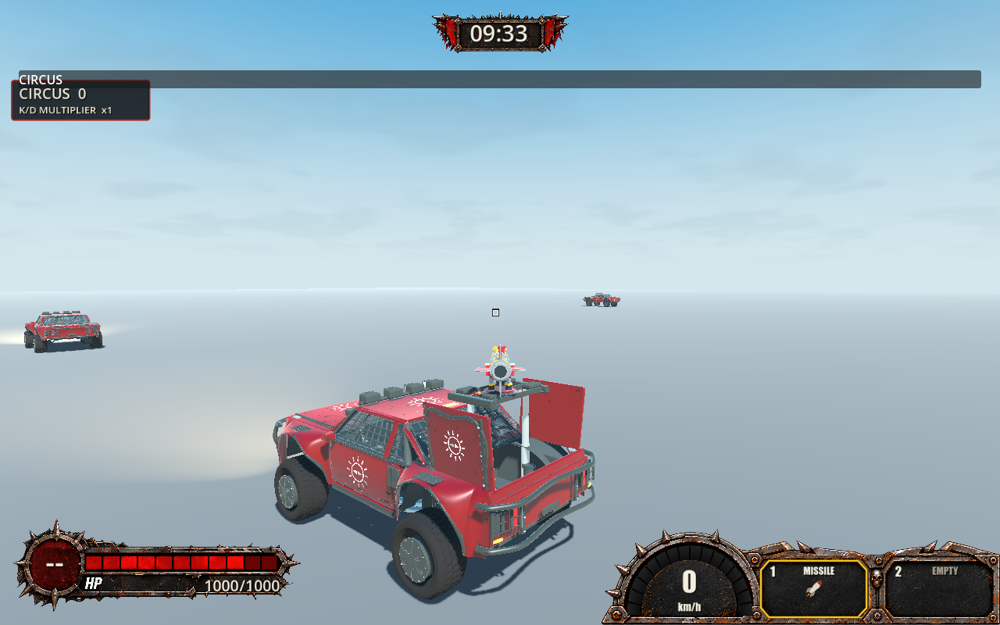
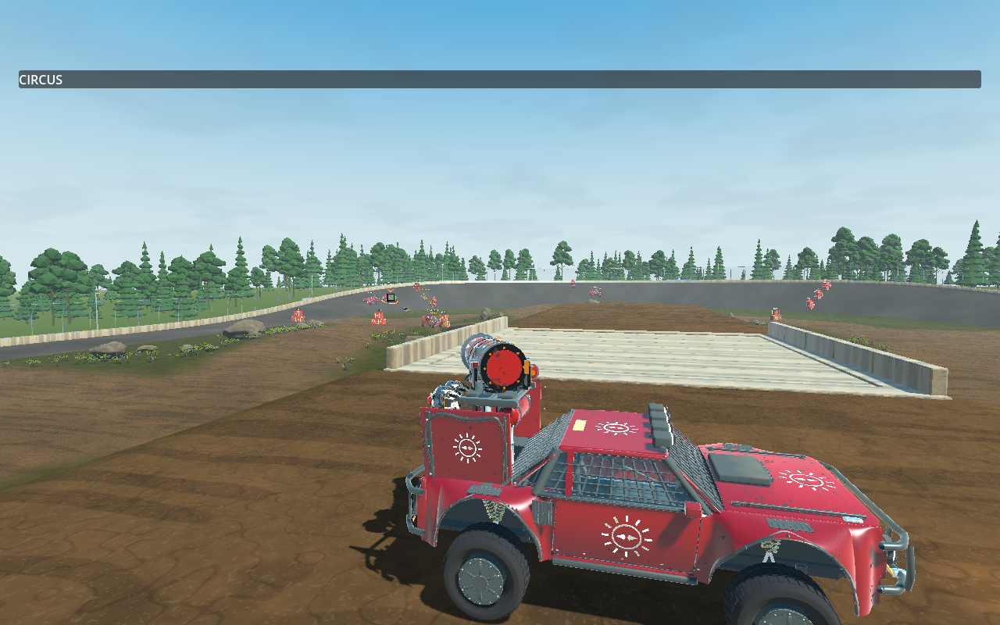

# TS-306 verification

Latest result: see **Approved polish — Round 2** below. Earlier failures and scores are retained as historical evidence.

## Implemented

Base: merged TS-305, origin/main `bd4813fb`. Existing Story branch: `ts-306-pg`.
Read TS-304/305/306 descriptions and comments (no comments returned). TS-306 recommends 6 Astra / Medium; the active model is Astra.

- A dismissed living car no longer rearms merely by moving outside the acquisition envelope. Deliberate return input must accumulate 0.012 radians, directed toward the car and opposite departure. Other input decays this accumulation at 20/s.
- Manual lead preserves the released cursor offset instead of elastically returning it toward screen center. Neutral controller input preserves the manual camera bearing while dismissal remains active.
- Existing acquisition tuning, progressive release, square/green feedback, weapon authority and projectile behavior remain unchanged.
- Added return-intent tests at 30/60/144 Hz and two native five-shot Salvo manual-lead volleys. The Salvo switching driver now aims from the visible cursor ray rather than assuming the cursor is centered.
- No Story version increment or version-file edit; version changes inherited from merged main only. No Jira modifications.

## Commands and evidence

`$g` denotes `.godot/godot-ci/4.7.2/Godot_v4.7.2-stable_mono_win64/Godot_v4.7.2-stable_mono_win64_console.exe`. Logs below are ignored local files under `.godot/`.

| Command | Result |
| --- | --- |
| `dotnet restore Trackstorm.sln --force --no-cache` | PASS. Cleared initial NU1900 vulnerability-lookup failures without disabling audit. |
| `dotnet test code/TransportTests/Trackstorm.Transport.Tests.csproj -c Debug --no-restore --filter 'FullyQualifiedName~MagneticAimCursorTests\|FullyQualifiedName~CameraAimAttractionTests' -warnaserror -m:1 -nr:false` | PASS, 22 tests. |
| `./check.ps1` | PASS, Debug production and Release solution warnings-as-errors builds; 1,518 Core and 501 client/transport tests. Final production-state log: `ts-306-check-final.log`. |
| `./check-weapon-aim.ps1 -GodotPath $g -NoBuild -Magnetic -Visual -Impaired` | PASS, 50 checks (`ts-306-magnetic-rendered.log`). |
| `./check-hosted-practice.ps1 -GodotPath $g -NoBuild -ControllerEmp` | PASS, repeated tabletop three-car acquisition/switching/actual launches (`ts-306-emp.log`). |
| `dotnet build Trackstorm.Client.csproj -c Debug --no-restore -warnaserror -m:1 -nr:false` | PASS after cursor-based Salvo fixture correction (`ts-306-build.log`). |
| `git diff --check` | PASS before delivery documentation. |

The comprehensive run includes all production changes. Subsequent source changes add diagnostic assertion text and correct the native Salvo input helper; the later Debug build compiles those changes. An earlier comprehensive run also passed but preceded the controller neutral-bearing change and is not final evidence.

## Runtime evidence and investigations

VERIFIED: rendered magnetic probe covers mouse/controller left/right departure at 35/200 m, visible square, bounded sampled cursor motion, independently queried cursor-ray agreement and actual Missile launches. Reviewed `magnetic-lead-200-False-1.png` in `.godot/aim-checks/47e9e829d2d24949a61f5a62e2b1496f/`: white square remains visible between rival cars after release. Screenshots establish static appearance, not human feel.

VERIFIED: native hosted EMP probe exercises route-driven practice cars, repeated three-car switching and authoritative launches using synthetic stick input. It does not prove physical-controller comfort or all projectile hits.

VERIFIED: both new manual-lead Salvo volleys passed in headless and rendered runs: acquire, release left/right, move a fixture rival and continue small outward mouse input while all five authoritative shots remain unassisted. Existing long-range front/side/rear held volleys passed before the switching failure described below.

Initial sandbox native run completed 50 assertions but its wrapper failed on user-log/certificate-store access. Elevated runs removed those environment errors. Two elevated headless magnetic runs failed the positive-controller departure assertion: target released, but `moved=False` indicated no sampled displacement above two pixels while retained. Rendered execution passed unchanged assertions. Root cause is not established; render/physics sampling sensitivity is a hypothesis, not a verified explanation.

The first headless and rendered Salvo polish runs failed `All switched authoritative arcs reach their newly selected rival; old arcs remain unchanged`. The driver used camera center instead of the persistent visible cursor. Corrected the driver without weakening endpoint assertions; subsequent result is recorded below.

## Limitations and risks

UNVERIFIED: physical-controller and human mouse ergonomics; repeated human five-shot leading ahead/behind through banks and turns; all moving/parked/trailing practice-car combinations; full gameplay/camera regression suite; dedicated road/bank harness; long sustained sessions. Synthetic inputs and fixture trajectories do not establish those acceptance criteria.

Dismissal retains one prior target identity, as before; dense repeated switching needs further human evaluation. Neutral controller bearing now persists until return/selection/input/lifecycle clearing, requiring usability review. Version transition checking was not claimed or bypassed: the user explicitly prohibited versioning changes. CI remains independent.

## Final Salvo result

`& $g --headless --path . res://scenes/verification/weapon_aim_checks.tscn --quit-after 24000 --max-fps 60 -- --aim-salvo --salvo-polish` — FAIL (`ts-306-salvo-cursor.log`). Cursor-based input correction did not resolve the switched-authoritative-endpoint assertion. The fixture explanation alone is insufficient. Manual-lead volleys passed, but switching remains an unresolved integration failure; the Story is not acceptance-complete. Later unassisted-range and teardown cases in this suite were not reached.

## Astra Runtime Critique — Story Round 1

**Overall Score: 5.5 / 10. Quality Assessment: BELOW TARGET (<8.0).**

| Category | Score |
| --- | --- |
| Runtime functionality/integration | 5.0 |
| Controls/responsiveness (scripted evidence only) | 6.0 |
| Visual feedback | 7.0 |

VERIFIED: rendered mouse/controller departure and Missile-ray checks, native repeated practice EMP switching, two five-shot manual-lead Salvo volleys, and visible square in inspected rendered evidence. The manual-lead path works in these probes, but the repeated Salvo switching suite still fails. This is a limited operational critique, not a claim of physical playtesting or complete gameplay feel assessment.

**Problem:** Salvo target switches do not satisfy the established authoritative endpoint assertions. **Evidence:** reproduced in headless and rendered polish runs, and after correcting the input helper to use the cursor ray. **Severity:** High. **Impact:** accurate switching between shots is not established. **Suggested improvement:** record each switched shot's cursor ray, accepted direction, target identity and ground endpoint; identify whether the remaining mismatch is fixture timing or production attraction/articulation, and correct it without weakening assertions. **Scope:** In Scope. **Corrective Work Type:** Existing Task.

**Problem:** headless controller departure missed the visible pre-release motion sample while rendered mode passed. **Severity:** Medium. **Impact:** consistent gradual release across timing conditions remains uncertain. **Suggested improvement:** isolate render/physics sampling and measure continuous cursor displacement with frame-time diagnostics. **Scope:** In Scope. **Corrective Work Type:** Existing Task.

**Recommended Next Round:** resolve the reproducible Salvo endpoint failure first, then complete bank/road and physical mouse/controller scenarios. No further polish round is initiated by this critique. The branch is delivered with these failures explicitly disclosed, not marked complete.

# Approved polish — Round 2, October 30, 2026

This section is the current result and supersedes Round 1's unresolved switching result above. Work started at `14b21fda` on `ts-306-pg`. Updated TS-306 explicitly approves out-of-range Salvo lock, modest fine mouse control, progressive controller response and investigation of the two verification failures. Jira returned no comments. Latest fetched main remains `bd4813fb`, already in the branch. No version files, authoritative projectile code or Jira records were changed.

## Changes

- Salvo now shares the existing 300 m acquisition/retention viewing limit independently of projectile reach. Visibility, life, assistance and input eligibility remain required. Lock neither fires nor extends range; ordinary/aimed reach remains 65/130 m at default tuning.
- Armed mouse motion below 120 pixels/second uses 90% of prior gain, smoothly returning to full gain at 300 pixels/second. Existing displacement filtering and physical-input breakaway floor remain intact. Unarmed mouse response is unchanged.
- Stick response adds `a + (1-a)m²(3-2m)` after dead-zone normalization, with `a=0.65` armed and `a=0.25` unarmed. Existing armed exponent, sensitivity, inversion and filtering remain. Full-stick speed is unchanged. The existing minimum 0.15 dead zone was retained rather than expanded.
- Added fine-response invariants, native 200 m Salvo lock/five-shot range checks and per-shot accepted-direction comparisons. Updated native expectations to the actual cursor and progressive response contracts.

## Failure investigation

The full Salvo diagnostic reproduced an 8.6781 m endpoint error on **shot one immediately after packet-blackout recovery**, while shots 2–5 were within 2.6 m. The isolated switch-only case passed. Reacquired target identity/green feedback precedes progressive attraction and accepted-ray convergence; the fixture incorrectly treated reacquisition as completed aim. The hit-on-car case now waits for the actual accepted ray to reach the first car before activation. The existing switched endpoint assertion remains unchanged. Every shot, including deliberately unassisted shots, is also compared with the target resolved from its own accepted direction. No projectile correction, hidden leading or aim snapping was added. The complete resulting Salvo suite passed 118 checks.

For headless departure, the old probe began input immediately after acquisition and sampled two physics ticks at a time. It now allows acquisition to settle and samples each advanced physics step after presentation, retaining the original two-pixel movement and bounded-travel assertions. A diagnostic attempt that awaited only render frames expired accepted aim because this fixture advances authority inside `Frames`; that attempt was corrected, not treated as gameplay evidence. Final headless results logged deliberate magnetic departure in every case, with retained cursor gaps of 4.459–7.770 pixels. Post-final rendered execution also passed.

The slower practice driver encountered a real route-car occlusion during sequence two. Production correctly released it. The fixture now seeks 20 consecutive neutral retained frames before firing, reacquiring through ordinary input after occlusion. It still requires each requested identity, actual launches and remote ammo accounting.

Road validation contained pre-magnetic assumptions: camera center instead of visible cursor, car-center direction instead of submitted hull-intersection/parallax intent, and instantaneous comparison across impaired UDP delivery. It now compares visible cursor alignment and accepted direction against submitted rays from the preceding 15 physics ticks (250 ms, below existing 300 ms expiry), retaining the .006/.03-radian bounds and native self-clearance assertions. Four-pixel outward/return nudges replace the previous 16-pixel sweeps in the uninterrupted-retention case: diagnostics showed the latter deliberately released. Large departures remain separately required by magnetic and Salvo checks. These fixture changes are disclosed; the road pass does not claim 16-pixel sweeps remain locked.

## Commands and results

`$g` is the pinned Godot executable defined above. Logs are under `.godot/ts-306-round2/`.

| Actual command | Result |
| --- | --- |
| `dotnet test code/TransportTests/Trackstorm.Transport.Tests.csproj -c Debug --filter 'FullyQualifiedName~CameraFreeLookTests\|FullyQualifiedName~MagneticAimCursorTests\|FullyQualifiedName~CameraAimAttractionTests' -warnaserror -m:1 -nr:false` | PASS, 36 (`targeted.log`). |
| `./tools/check-fast.ps1 -Area Transport -OutputDirectory .godot/ts-306-round2/fast` | PASS, 504 tests; structured `fast/results.json`. |
| `& $g --headless --path . res://scenes/verification/weapon_aim_checks.tscn --quit-after 24000 --max-fps 60 -- --aim-salvo --salvo-polish` | PASS, 118 checks (`salvo-verified.log`). |
| `./check-weapon-aim.ps1 -GodotPath $g -Magnetic -Impaired` | PASS, 50, after fixture correction (`magnetic-corrected.log`). |
| `./check-hosted-practice.ps1 -GodotPath $g -ControllerEmp -Visual` | PASS, two three-car sequences with native moving practice cars and six actual EMP launches (`practice-emp-stable.log`). |
| `./check-camera.ps1 -GodotPath $g` | PASS, native settings/rates/inversion, double 360 orbits, framing and lifecycle (`camera-updated.log`). |
| `./check-weapon-aim.ps1 -GodotPath $g -Road -Visual -Impaired` | PASS, 56 checks, all nine distance/device/rate modes (`road-verified.log`). |
| `./check.ps1` | PASS, warnings-as-errors Debug production and Release solution builds, 1,518 Core and 504 client/transport tests (`check-final.log`). |
| `./check-weapon-aim.ps1 -GodotPath $g -NoBuild -Magnetic -Visual -Impaired` | PASS, 50 checks **after comprehensive verification**, used for final operational critique (`critique-magnetic.log`). |
| `git diff --check` | PASS. |

Final comprehensive verification includes all production and fixture changes. Subsequent edits are this report and captured evidence only. Earlier failed diagnostic/native runs remain in the local log directory; they are not represented as passes. No final failure remains in the executed checks.

## Runtime evidence and limits

VERIFIED: 200 m Salvo acquisition beyond default reach without automatic fire; all five rounds retain their range/ammo rules; repeated moving-target retention, left/right mouse manual-lead volleys, front/side/rear holds and switched volleys; every shot snapshots accepted aim independently; old arcs stay fixed. Manual Salvo input is scripted mouse, and its moving rivals are fixture-driven.

VERIFIED: rendered mouse/controller magnetic departure at 35/200 m, persistent square and actual Missile launches aligned with cursor intent. Practice EMP uses synthetic right-stick input and real TS-303 route cars on the oval, from a tabletop shooter, with repeated switching/reacquisition and normal occlusion. Road uses native shooter throttle/suspension over production rollers at 8/35/200 m, synthetic rival motion, 30/60/144 FPS, FOV 50/90 and simulated 30 ms delay/5 ms jitter/2% packet loss. All nine modes retained the eligible rival for 360/360 measured samples with fine corrections. This does not establish human handling on every bank trajectory.

Reviewed road capture `.godot/aim-checks/319329a38a4548cab03ac8ca79344ded/road-35-1.png`, the practice capture below and the post-final controller departure capture below. Static images support cursor/feedback visibility; continuous response findings come from executed probes, not screenshots alone.

UNVERIFIED: physical-controller ergonomics and 10–20% hand deflection comfort, human mouse preference for the 10% fine gain, human five-shot Salvo lead ahead/behind on banks, scripted controller-specific full Salvo lead volleys, and extended human sessions. Controller shared aiming and EMP coverage do not substitute for a physical-controller Salvo playtest. The complete all-weapon suite was not rerun; this round ran the scoped native suites listed above. Version-transition CI remains outside the permitted changes; no version gate pass is claimed.

## Astra Runtime Critique — Story Round 2

**Overall Score: 7.5 / 10. Quality Assessment: BELOW TARGET (<8.0).**

| Runtime category | Score |
| --- | --- |
| Functionality/integration | 8.0 |
| Controls/responsiveness | 7.0 |
| Camera | 8.0 |
| Visual feedback/readability | 7.5 |

The exercised result is coherent: manual departure stays free, selected-shot direction remains truthful, repeated target switches work, and distant Salvo acquisition no longer depends on projectile reach. Native camera checks preserve full turning and framing; inspected captures retain readable square/lock feedback. No numerical score for physical ergonomics is implied.

**Recommendation:** validate the new fine-control response physically before acceptance. **Problem:** comfort and precision of the slower small-deflection response remain uncertain. **Evidence:** synthetic device events and feedback drivers only; no physical playtest this round. **Severity:** Medium. **Impact:** a player may find fine tracking too slow or transitions less natural despite deterministic passes. **Suggested improvement:** on the tabletop, test 10–20% stick tracking followed by fast 360 turns, then two Salvo magazines leading ahead/behind and returning to lock; repeat mouse and the three-car EMP sequence. Report specific overshoot, resistance or unwanted reacquisition before requesting more tuning. **Scope:** In Scope. **Corrective Work Type:** No Code Change Required initially.

**Recommended Next Round:** human mouse/controller playtest and acceptance decision. Further tuning requires explicit authorization. No additional polish round started after this critique.
