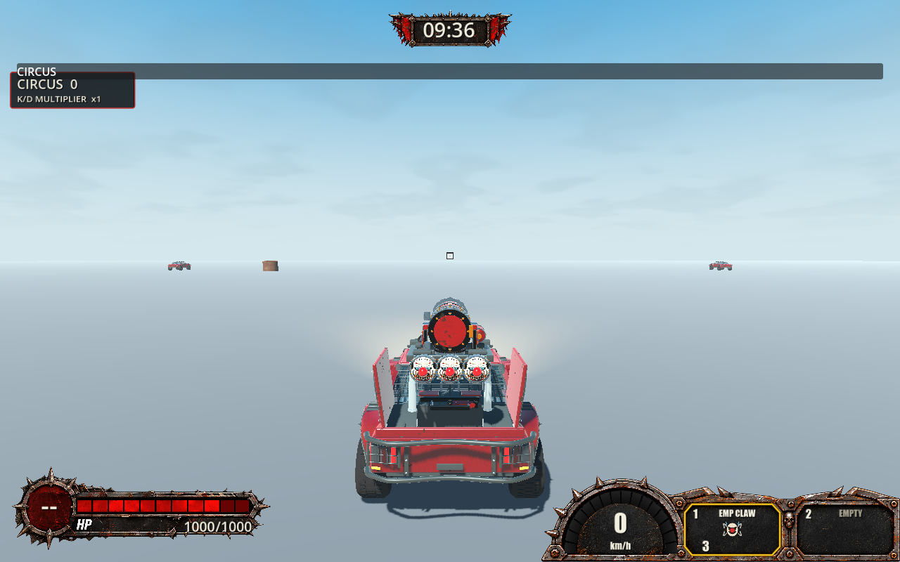
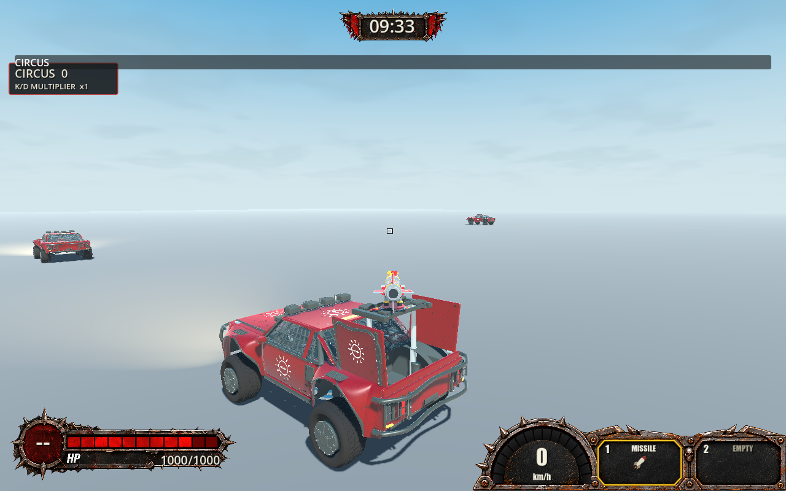

# TS-307 verification

## Implemented

Base `143fd03ff04c9376357c7d514947e69eb8cc6332`, branch `ts-307-pg`. Inspected TS-302–307, TS-307 children/comments (none), High front image, repository workflow/standards, relevant contracts and existing implementation. Jira recommends 6.1 Sol / Medium; execution used active Astra without changing that recommendation.

- Gameplay Crosshair Size: 0.5–3×, increments 0.05, original-size default 1×. Existing JSON persistence, immediate snapshot and global reset; visual scaling never enters aim calculations.
- Machine Gun, Missile, EMP Claw and Salvo use chassis-forward intent without camera aim. Driving square projects that line 300 m from the rack pivot, above the payload. Active aiming retains acquisition/retention/switching/manual lead.
- Readiness feedback includes local deployment, returning Wrench and EMP cooldown. Existing white/red/green states and persistent square remain; active retention retains green precedence.
- Default downward articulation uses the existing supported 60° range instead of 40°. Direct-fire body clearance still imposes physical limits; Salvo retains its arcing exception. Existing 85° downward camera travel exceeds the weapon range.
- Added settings/downward deterministic tests, native persistence/reset assertions and the four-weapon `-Driving` fixture. Projectile/guidance and non-aimed deployment implementations are unchanged.
- Updated feature docs; repository version tool synchronized 0.2.72/export metadata.

## Commands and results

`$g` is `.godot/godot-ci/4.7.2/Godot_v4.7.2-stable_mono_win64/Godot_v4.7.2-stable_mono_win64_console.exe`. Logs below are ignored files under `.godot/`.

| Command | Actual result |
| --- | --- |
| Targeted dotnet test, PlayerSettingsTests and WeaponAimTests | PASS, 56 before final downward test addition. |
| `./tools/check-fast.ps1 -Area Core -OutputDirectory .godot/ts307-fast` | PASS, 1,520 Core tests. |
| `dotnet restore Trackstorm.sln --force --no-cache` | PASS with network access and auditing enabled. |
| `./check.ps1` | PASS, warnings-as-errors Debug production/Release solution builds; 1,520 Core and 504 client/transport tests (`ts307-check-final.log`). |
| `./check-weapon-aim.ps1 -GodotPath $g -NoBuild -Driving -Visual -Impaired` | PASS, 34 checks, four weapons and three UDP peers (`ts307-driving-final.log`). |
| `./check-settings.ps1 -GodotPath $g -NoBuild -Visual` | PASS: write 8, separate-process read 30, rendered UI/reset 74 assertions (`ts307-settings-final.log`). |
| `./check-weapon-aim.ps1 -GodotPath $g -NoBuild -Missile -Impaired` | PASS, 272 checks: direction, downward self-block, stow, native flight and ordered peer outcomes (`ts307-missile-final.log`). |
| `./check-weapon-aim.ps1 -GodotPath $g -NoBuild -Magnetic -Visual -Impaired` | PASS, 50 synthetic mouse/controller departure and actual launch checks (`ts307-magnetic-final.log`). |
| `& $g --headless --path . res://scenes/verification/weapon_aim_checks.tscn --quit-after 24000 --max-fps 60 -- --aim-salvo --salvo-polish` | PASS, 118 checks: five-shot manual lead, switching, distant acquisition, independent accepted shot directions (`ts307-salvo-final.log`). |
| `./check-weapon-aim.ps1 -GodotPath $g -NoBuild -MachineGun -Visual -Impaired` | PASS, 82 checks, 984 native rays, 472 target hits; observer muzzle error at most 0.000005 m (`ts307-machinegun-rendered.log`). |
| `./check-hosted-practice.ps1 -GodotPath $g -NoBuild -ControllerEmp -Visual` | FAIL twice, including isolated repeat: authoritative EMP did not capture requested retained car (`ts307-practice-final.log`, `ts307-practice-isolated.log`). |
| `./tools/check-version.ps1` | PASS. |

Initial comprehensive run failed on NuGet audit-service access; fresh restore and full rerun passed. Initial Missile assertions passed but wrapper rejected sandbox log/certificate errors; final native rerun passed. Headless Machine Gun failed a rendering-only pre-draw assertion with zero samples; rendered rerun passed. Driving fixture development corrected missing initial trigger engagement and an incorrect empty-slot token assumption. Earlier attempts are not passes.

## Runtime evidence, risks and limitations

VERIFIED: square above rendered payloads, forward fire and ammo consumption for all four aimed weapons, settings persistence/reset, synthetic mouse/controller aiming, authoritative shot/observer agreement, self-obstruction rejection, repeated Salvo/Missile/Machine Gun use. Runtime checks used the comprehensive build; subsequent changes are documentation/evidence only.

EMP practice passed multiple shots but failed expected-target capture in sequence two. The isolated repeat reached the last car and logged `reason=occluded` immediately before failure. The fixture waits after checking retention before firing; authority independently checks current cone and sight. A timing/visibility cause is INFERRED, not established for both failures. Safety and assertions were not weakened. This unresolved repeated-practice scenario prevents claiming complete acceptance verification.

UNVERIFIED: physical-controller ergonomics, hands-on mouse feel, human approval of square placement/default size, all camera-setting extremes with raised cursor, sustained banks/jumps across every weapon, physical-controller full Salvo volleys, authenticated EOS/WAN/two-device operation, and a clean repeated EMP practice sequence. Driving matrix holds fixture poses; moving coverage comes from separate Missile/Machine Gun/practice runs. New maximum downward range has deterministic/codec coverage; each weapon's physical limit was not manually observed. Non-aimed items have deterministic regressions, not new dedicated native Oil testing.

## Astra Runtime Critique — Story Round 1

**Overall Score: 6.8 / 10. Quality Assessment: BELOW TARGET (<8.0).**

| Observed category | Score |
| --- | --- |
| Runtime functionality/integration | 7.0 |
| Controls/responsiveness, synthetic evidence | 7.0 |
| Visual feedback/readability | 7.5 |
| Multiplayer experience, local UDP only | 6.0 |

The rendered cursor clears the payload, four weapons fire through the shared driving path, settings persist/reset, and exercised leading/shot paths are coherent. Repeated EMP target-capture failure leaves meaningful integration uncertainty. Screenshots support placement; native execution supports motion/authority findings. No physical-device or WAN assessment is implied.

**Problem:** repeated practice EMP launches fail the selected-target assertion. **Evidence:** two native failures, with occlusion immediately before the isolated repeat's failure. **Severity:** Medium. **Impact:** local retention may not predict which guided target authority accepts at firing time. **Suggested improvement:** instrument candidate, accepted ray and host sight at the firing tick; distinguish legitimate occlusion from presentation/authority mismatch, then rerun six shots without weakening safety. **Scope:** In Scope. **Corrective Work Type:** Existing Task.

**Recommended Next Round:** resolve the EMP verification uncertainty, then human mouse/controller playtest all weapons, downward shots, banks/jumps and size adjustment. New size baseline requires human approval. Stop for human direction; no automatic polish follows this critique.
