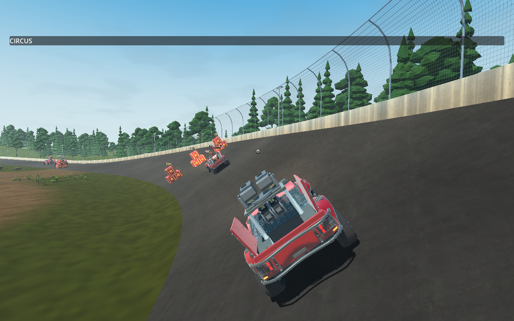
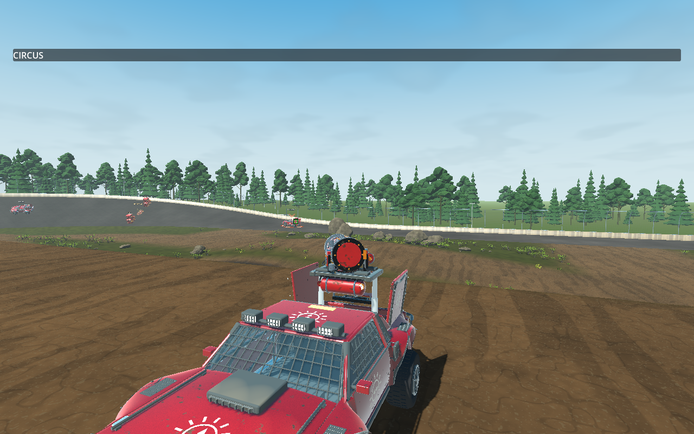

# TS-307 verification

## Implemented

Base `143fd03ff04c9376357c7d514947e69eb8cc6332`, branch `ts-307-pg`. Inspected TS-302–307, TS-307 children/comments (none), High front image, repository workflow/standards, relevant contracts and existing implementation. Jira recommends 6.1 Sol / Medium; execution used active Astra without changing that recommendation.

- Gameplay Crosshair Size: 0.5–3×, increments 0.05, original-size default 1×. Existing JSON persistence, immediate snapshot and global reset; visual scaling never enters aim calculations.
- Machine Gun, Missile, EMP Claw and Salvo use chassis-forward intent without camera aim. Driving square projects that line 300 m from the rack pivot, above the payload. Active aiming retains acquisition/retention/switching/manual lead.
- Readiness feedback includes local deployment, returning Wrench and EMP cooldown. Existing white/red/green states and persistent square remain; active retention retains green precedence.
- Default downward articulation uses the existing supported 60° range instead of 40°. Direct-fire body clearance still imposes physical limits; Salvo retains its arcing exception. Existing 85° downward camera travel exceeds the weapon range.
- Added settings/downward deterministic tests, native persistence/reset assertions and the four-weapon `-Driving` fixture. Projectile/guidance and non-aimed deployment implementations are unchanged.
- Updated feature docs; repository version tool synchronized 0.2.72/export metadata.

## Commands and results

`$g` is `.godot/godot-ci/4.7.2/Godot_v4.7.2-stable_mono_win64/Godot_v4.7.2-stable_mono_win64_console.exe`. Logs below are ignored files under `.godot/`.

| Command | Actual result |
| --- | --- |
| Targeted dotnet test, PlayerSettingsTests and WeaponAimTests | PASS, 56 before final downward test addition. |
| `./tools/check-fast.ps1 -Area Core -OutputDirectory .godot/ts307-fast` | PASS, 1,520 Core tests. |
| `dotnet restore Trackstorm.sln --force --no-cache` | PASS with network access and auditing enabled. |
| `./check.ps1` | PASS, warnings-as-errors Debug production/Release solution builds; 1,520 Core and 504 client/transport tests (`ts307-check-final.log`). |
| `./check-weapon-aim.ps1 -GodotPath $g -NoBuild -Driving -Visual -Impaired` | PASS, 34 checks, four weapons and three UDP peers (`ts307-driving-final.log`). |
| `./check-settings.ps1 -GodotPath $g -NoBuild -Visual` | PASS: write 8, separate-process read 30, rendered UI/reset 74 assertions (`ts307-settings-final.log`). |
| `./check-weapon-aim.ps1 -GodotPath $g -NoBuild -Missile -Impaired` | PASS, 272 checks: direction, downward self-block, stow, native flight and ordered peer outcomes (`ts307-missile-final.log`). |
| `./check-weapon-aim.ps1 -GodotPath $g -NoBuild -Magnetic -Visual -Impaired` | PASS, 50 synthetic mouse/controller departure and actual launch checks (`ts307-magnetic-final.log`). |
| `& $g --headless --path . res://scenes/verification/weapon_aim_checks.tscn --quit-after 24000 --max-fps 60 -- --aim-salvo --salvo-polish` | PASS, 118 checks: five-shot manual lead, switching, distant acquisition, independent accepted shot directions (`ts307-salvo-final.log`). |
| `./check-weapon-aim.ps1 -GodotPath $g -NoBuild -MachineGun -Visual -Impaired` | PASS, 82 checks, 984 native rays, 472 target hits; observer muzzle error at most 0.000005 m (`ts307-machinegun-rendered.log`). |
| `./check-hosted-practice.ps1 -GodotPath $g -NoBuild -ControllerEmp -Visual` | FAIL twice, including isolated repeat: authoritative EMP did not capture requested retained car (`ts307-practice-final.log`, `ts307-practice-isolated.log`). |
| `./tools/check-version.ps1` | PASS. |

Initial comprehensive run failed on NuGet audit-service access; fresh restore and full rerun passed. Initial Missile assertions passed but wrapper rejected sandbox log/certificate errors; final native rerun passed. Headless Machine Gun failed a rendering-only pre-draw assertion with zero samples; rendered rerun passed. Driving fixture development corrected missing initial trigger engagement and an incorrect empty-slot token assumption. Earlier attempts are not passes.

## Runtime evidence, risks and limitations

VERIFIED: square above rendered payloads, forward fire and ammo consumption for all four aimed weapons, settings persistence/reset, synthetic mouse/controller aiming, authoritative shot/observer agreement, self-obstruction rejection, repeated Salvo/Missile/Machine Gun use. Runtime checks used the comprehensive build; subsequent changes are documentation/evidence only.

EMP practice passed multiple shots but failed expected-target capture in sequence two. The isolated repeat reached the last car and logged `reason=occluded` immediately before failure. The fixture waits after checking retention before firing; authority independently checks current cone and sight. A timing/visibility cause is INFERRED, not established for both failures. Safety and assertions were not weakened. This unresolved repeated-practice scenario prevents claiming complete acceptance verification.

UNVERIFIED: physical-controller ergonomics, hands-on mouse feel, human approval of square placement/default size, all camera-setting extremes with raised cursor, sustained banks/jumps across every weapon, physical-controller full Salvo volleys, authenticated EOS/WAN/two-device operation, and a clean repeated EMP practice sequence. Driving matrix holds fixture poses; moving coverage comes from separate Missile/Machine Gun/practice runs. New maximum downward range has deterministic/codec coverage; each weapon's physical limit was not manually observed. Non-aimed items have deterministic regressions, not new dedicated native Oil testing.

## Astra Runtime Critique — Story Round 1

**Overall Score: 6.8 / 10. Quality Assessment: BELOW TARGET (<8.0).**

| Observed category | Score |
| --- | --- |
| Runtime functionality/integration | 7.0 |
| Controls/responsiveness, synthetic evidence | 7.0 |
| Visual feedback/readability | 7.5 |
| Multiplayer experience, local UDP only | 6.0 |

The rendered cursor clears the payload, four weapons fire through the shared driving path, settings persist/reset, and exercised leading/shot paths are coherent. Repeated EMP target-capture failure leaves meaningful integration uncertainty. Screenshots support placement; native execution supports motion/authority findings. No physical-device or WAN assessment is implied.

**Problem:** repeated practice EMP launches fail the selected-target assertion. **Evidence:** two native failures, with occlusion immediately before the isolated repeat's failure. **Severity:** Medium. **Impact:** local retention may not predict which guided target authority accepts at firing time. **Suggested improvement:** instrument candidate, accepted ray and host sight at the firing tick; distinguish legitimate occlusion from presentation/authority mismatch, then rerun six shots without weakening safety. **Scope:** In Scope. **Corrective Work Type:** Existing Task.

**Recommended Next Round:** resolve the EMP verification uncertainty, then human mouse/controller playtest all weapons, downward shots, banks/jumps and size adjustment. New size baseline requires human approval. Stop for human direction; no automatic polish follows this critique.

## Human-authorized polish — Round 2 (2026-10-30)

This section supersedes the Round 1 chassis-forward/300 m description and its unresolved EMP-fixture diagnosis. Inspected the updated TS-307 Jira Story and approved human feedback, repository routing, camera/aiming contracts, current implementation and prior evidence. Round 2 starts at `4659f9ef20f0081b76f1e818604e7a9f00fa9d8d` on the existing `ts-307-pg` branch. Current main was fetched before implementation and delivery; no incoming main commits required integration. Story version remains 0.2.72.

### Changes and root causes

- Raw chassis pitch included suspension movement in the ordinary-driving ray; projecting it 300 m amplified visible motion. A horizontal ray from the elevated rack also passed above cars ahead. Ordinary driving now derives heading from the displayed vehicle and grade from native road geometry, depresses it 1.5 degrees, and uses a 60 m convergence point. Road normal smoothing (8/s) and driving-only camera-relative elevation smoothing (6/s) stabilize that point. Both the visible square and submitted aim direction use it; authority still owns the physical pivot, articulation, clearance and actual shot. This is neither a cosmetic cursor offset nor target-seeking projectile correction. Active camera input and vehicle physics are unchanged.
- Added a native moving-TS-303-car scenario exposed through `check-hosted-practice.ps1 -DrivingMachineGun -Visual`: normal steering/throttle, no aim mode or assistance, actual native ray hits/damage, repeated bursts, bank traversal, visibility and synchronized jitter measurements. Added three deterministic road-grade/pitch/clearance cases and updated the four-weapon/Missile expectations.
- EMP practice used retention sampled before subsequent rendering/frame waits. Instrumentation reproduced a firing-time native occlusion, including a case where retention still existed. The fixture now rechecks retained identity, candidate, accepted readiness/cone and native sight immediately before requesting fire, with bounded reacquisition and no spent ammunition while deferring. Every fired projectile must still capture the requested car. No EMP mechanics, target selection or authority rules were changed.
- Preserved Crosshair Size persistence/default/reset, existing state colors, active-aim acquisition/leading/breakaway, downward articulation and weapon-specific consumers. Feature docs and targeted-check routing describe the new scenario.

### Round 2 commands and actual results

`$g` retains the pinned Godot path above. Logs are local ignored files under `.godot/`.

| Command | Result / evidence |
| --- | --- |
| Targeted `DrivingWeaponAimTests` | PASS, 3 cases. |
| `./tools/check-fast.ps1 -Area Transport -OutputDirectory .godot/ts307-r2-fast` | PASS, 507 tests. |
| `./check.ps1` | PASS: Debug production and Release solution builds, zero warnings/errors; 1,520 Core and 507 client/transport tests. `ts307-r2-check-final.log`. |
| `./check-hosted-practice.ps1 -GodotPath $g -NoBuild -DrivingMachineGun -Visual` (isolated) | PASS: 251/264 native shots hit (95.1%), target minimum HP 521.62 from 1,000, 1,180.1 m travel, 1,874 bank samples, square visible 3,000/3,000 samples. Jitter 196.0 → 132.9 (32.2% reduction); vertical travel 391.4 → 318.0 px. `ts307-r2-driving-isolated.log`. |
| Same final-build driving command alongside other rendered checks | FAIL jitter threshold: 210.9 → 317.1, despite 512/566 hits and 1,973.7 m travel. `ts307-r2-driving-final.log`. This failure is retained; isolated success does not establish stability under variable rendering load. |
| `./check-hosted-practice.ps1 -GodotPath $g -NoBuild -ControllerEmp -Visual` | PASS, six actual captures over two three-car sequences and deliberate release. One native occlusion deferred, then reacquired without ammunition loss. `ts307-r2-emp-final.log`; earlier instrumented run also passed. |
| `./check-weapon-aim.ps1 -GodotPath $g -NoBuild -Driving -Visual -Impaired` | PASS, 34 checks across four weapons and three local UDP peers. `ts307-r2-four-final.log`. |
| Same wrapper with `-Missile -Impaired` | PASS, 272 checks: straight/side/rear/downward and self-blocked fire, native airborne/landing, matching ordered outcomes. `ts307-r2-missile-final.log`. |
| Same wrapper with `-Magnetic -Visual -Impaired` | PASS, 50 synthetic mouse/controller acquisition, departure and launch checks. `ts307-r2-magnetic-final.log`. |
| `& $g --headless --path . res://scenes/verification/weapon_aim_checks.tscn --quit-after 24000 --max-fps 60 -- --aim-salvo --salvo-polish` | PASS, 118 repeated-volley, leading, switching, base-range and observer-outcome checks. `ts307-r2-salvo-final.log`. |
| `./check-settings.ps1 -GodotPath $g -NoBuild -Visual` | PASS: write 8, separate-process read 30, rendered/reset 74 assertions. `ts307-r2-settings-final.log`. |
| `./tools/test-workflow-tools.ps1` | PASS, 217 assertions; logged failure/timeout fixtures are expected negative tests. `ts307-r2-workflow-tools.log`. |
| `./tools/sync-story-version.ps1`, `./tools/check-version.ps1` | PASS, unchanged 0.2.72 and export 0.2.72.0. |

Earlier development runs are not passes: the route test initially used an incorrect bank boundary; final-HP-only assertions missed intermediate damage after recovery; raw road-normal and rendered-origin-only variants failed jitter; elevation filtering at 8/s reduced jitter only 23%, below the 30% check. The final 6/s isolated run passed without weakening that threshold or the 75% aligned-fire hit requirement.

### Round 2 runtime evidence and limitations

VERIFIED: native ordinary-driving pursuit and hits against a moving TS-303 car, banked turns, repeated firing, clear visible square, final-build shared four-weapon acceptance, six EMP captures, synthetic mouse/controller magnetic behavior, settings reset/persistence and local impaired-UDP outcomes.

The automated driver fires when aligned with the target; its 95.1% hit rate is not a human accuracy claim or a guarantee at arbitrary ranges. Jitter uses the sum of absolute changes in frame-to-frame vertical displacement, compared with the prior raw-chassis projection in the same run. It measures high-frequency motion, not subjective comfort. The loaded run failed, so broad frame-pacing stability remains unresolved.

UNVERIFIED: hands-on mouse/controller tracking feel, physical-controller ergonomics, human approval of the unchanged 1× default size and lower placement, all camera-setting extremes, every weapon over every jump/bank configuration, real WAN/authenticated EOS/two-device operation, and dedicated new native Oil deployment. Missile supplied native jump/landing evidence; the primary MG pursuit supplied sustained banks. Existing non-aimed-item deterministic regressions passed. No claim of complete human acceptance or stable behavior under all rendering loads is made.

Additional final checks: main-scene startup (`$g --headless --path . --quit-after 120`) exited 0 (`ts307-r2-startup-final.log`). Astra's fresh `check-weapon-aim.ps1 -GodotPath $g -NoBuild -MachineGun -Visual -Impaired` first failed the peer-1 both-barrels assertion after 20 physics frames (host 18/18 hits; peer 1 one left/no right presentation). An unchanged isolated repeat passed all 82 checks: 982 native rays, 472 target hits, 491 left/491 right pre-draw births on every peer, matching 982 ordered events and maximum endpoint error 0.000005 m. Logs: `ts307-r2-mg-critique.log`, `ts307-r2-mg-critique-repeat.log`. Fixed physics-frame sampling before presentation catches up is a plausible explanation, not an established root cause. Neither the initial failure nor the loaded-driving failure is erased by a repeat pass.

## Astra Runtime Critique — Story Round 2

**Overall Score: 7.1 / 10. Quality Assessment: BELOW TARGET (<8.0).**

Performed by an explicitly requested Astra agent after comprehensive verification, with direct native execution and rendered-image inspection. The driving square clears the rack on flat ground and banking. Isolated driving shows reduced jitter and six EMP captures respect current firing visibility. The same build worsened measured jitter under concurrent rendered verification, preventing a polished/robust assessment.

| Runtime category | Score |
| --- | --- |
| Functionality / integration | 7.8 |
| Controls / responsiveness (scripted) | 7.2 |
| Camera / aim motion | 6.7 |
| Visual feedback / readability | 7.4 |
| Multiplayer experience (local impaired UDP) | 7.2 |
| Observed performance consistency | 6.3 |

**What was exercised:** Astra directly ran the failed MG scenario and passing 82-check repeat; viewed flat-ground, banked-driving, EMP and moving rapid-aim captures; and reviewed the recorded driving, six-shot EMP, four-weapon and settings evidence above. The repeat exercised simultaneous sustained shooters, release, expiry/resumption, suppression, switching and rapid moving aim. Static code quality is not part of this score.

**Runtime limitations:** no hands-on mouse/physical-controller, WAN/two-device or audio assessment; no exhaustive camera-setting or every-weapon bank/jump coverage. Scripted aligned firing does not establish human accuracy or comfortable tracking. The default 1× square is distinguishable but small. The initial MG presentation failure remains observed; its timing explanation is INFERRED.

**Problem 1:** driving stabilization does not consistently improve motion across rendering conditions. **Evidence:** isolated jitter decreased 32%, concurrent rendered jitter increased about 50% on the same final build. **Severity:** Medium. **Impact:** the aiming reference may become less predictable under load despite successful hits. **Suggested improvement:** reproduce at controlled frame rates with frame-time capture; observe the square and accepted aim together and resolve frame-dependent behavior while preserving agreement. **Scope:** In Scope. **Corrective Work Type:** Existing Task.

**Problem 2:** default readability and responsiveness lack human acceptance. **Evidence:** captures show a small square; control/firing evidence is scripted. **Severity:** Low. **Impact:** geometric correctness may still feel tiring or awkward. **Suggested improvement:** human mouse/controller session covering ordinary pursuit, banks, active-aim transitions and size adjustment; retain 1× until human approval of a new baseline. **Scope:** In Scope. **Corrective Work Type:** No Code Change Required.

**Recommended Next Round:** only if authorized, controlled loaded-render stabilization first, then human tracking/readability acceptance. Retain initial MG failure and successful repeat as timing-sensitive evidence. No automatic further polish; stop for human direction.
