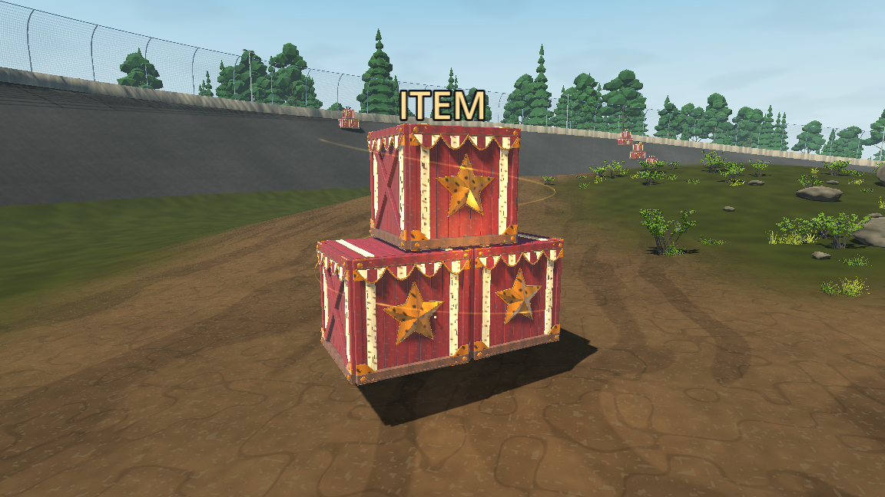
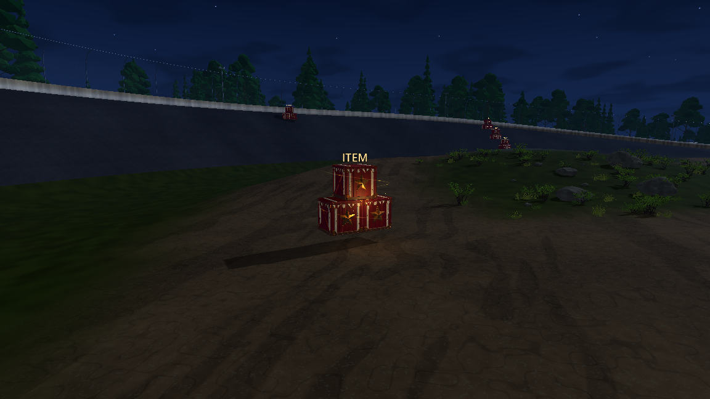
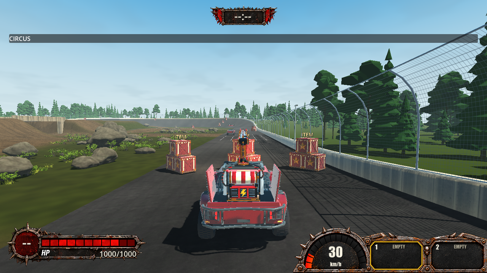

# TS-310 — Carnival crate intact pickup verification

Latest result: [Round 2 — approved polish](#round-2--approved-polish-and-floating-exception).
The original implementation and Round 1 critique below remain historical evidence;
Round 2 supersedes their placement, facing, material and current verification results.

2026-10-26. Branch `ts-310-pg`; base `07fbe227303478aee10f8730fa125c202f924470`.
TS-310 and TS-309 were read in full; neither had comments or attachments. The user
then supplied the approved intact `3 crates.png` and explosion reference. Only the
intact design is implemented. Its original reference is retained in the
import-excluded source directory with its SHA-256. Jira was not modified.
The Story recommends 6 Astra / Medium. This experiential review was performed by
the current Astra agent, not an independent engineering reviewer.

## Implemented

- One original Blender stack per existing marker: two lower crates, a centred
  upper crate, distressed red planks, ivory stripes, raised gold stars on opposite
  faces, side cross-braces, folded/riveted brass corners and scalloped striped trim.
- Editable Blender 5.2.2 master: 774 separate mesh components, authored UVs and nine
  packed images including generated wood normal maps. The GLB batches three named
  crate groups with shared materials: 53,040 triangles before Godot LODs; measured
  bounds 3.089 × 2.851 × 1.774 m.
- Fixed diagonal facing exposes the lower pair on oval approaches. All existing
  marker positions remain, including the elevated jump pickup. A 2.5 cm hover,
  bounded gold ribbon, 16 ambient motes and distance-faded light provide intact aura.
- Existing confirmed publications hide/reactivate the complete stack. No Core,
  selection, eligibility, radius, cooldown, inventory, protocol or authority code
  changed. The existing three-metre collection sphere remains the provisional
  interaction. There are no per-crate colliders or independent awards.
- Match-resource preload, source/provenance, feature documentation, targeted
  routing and native presentation checks are included. Story version 0.2.58 and
  export fields 0.2.58.0 follow the normal procedure; the Epic's 0.3.0 label does
  not authorize a release transition.
- No destruction, smash animation, confetti, fragments or TS-311 integration.

## Verification

Commands ran from the repository root. `$Godot` denotes
`C:/Users/orsin/OneDrive/Desktop/godot/Godot_v4.7.2-stable_mono_win64/Godot_v4.7.2-stable_mono_win64_console.exe`;
`$Blender` denotes `C:/Program Files/Blender Foundation/Blender 5.2/blender.exe`.
Environment: Windows, .NET SDK 10.0.401, Godot 4.7.2 .NET Compatibility, OpenGL 3.3,
NVIDIA GTX 1070.

| Command | Actual result |
| --- | --- |
| `git fetch origin`; `git rev-list --left-right --count HEAD...origin/main` | 0/0 before final verification. No Core changes in the Story diff. |
| `./tools/sync-story-version.ps1`; `./tools/check-version.ps1` | PASS, expected/actual 0.2.58 and matching export fields. |
| `& $Blender --background --python-exit-code 1 --python assets/items/carnival-crate/source/BuildCarnivalCrate.py` | PASS: editable master, packed textures, GLB and manifest. Palette and facing refined during ordinary implementation review. |
| `& $Blender --background --python-exit-code 1 --python assets/items/carnival-crate/source/AuditCarnivalCrate.py` | PASS: reopened source, three groups, 774 editable meshes, nine packed images, UVs, zero rigid bodies and valid hashes. [Audit](ts-310/asset-audit.json). |
| `./import-godot.ps1 -GodotPath $Godot` | PASS after normal editor/certificate-store access was granted; final import exit 0, no Godot warnings/errors. |
| `./tools/check-fast.ps1 -Area Client -OutputDirectory .godot/ts-310/targeted-crossings` | PASS, warning-free Debug build. Targeted builds also verified preceding meaningful code revisions. |
| `./check.ps1` | PASS on completed code and corrected native fixtures: audited restore, version/workflow/media regressions, five media checksums, Debug production and Release solution builds without warnings/errors, **1,475 Core tests and 469 transport/client tests**, no skipped tests in those suites. [Log](ts-310/check.log). |
| `./check-item-spawns.ps1 -GodotPath $Godot -NoBuild -Impaired -Oval -Visual` | PASS, isolated final run: eight native local UDP peers, all 27 pickup states, contested single award, cooldown/reactivation, occupied-slot rejection, 32 rounds per player and live weight edits preserving history/RNG. [Log](ts-310/multiplayer.log), [evidence](ts-310/multiplayer-evidence.txt). |
| `./check-pickup-drive.ps1 -GodotPath $Godot -NoBuild -Visual -Impaired` | PASS: both application peers acquire all nine registered items normally, fill two slots, reject full-inventory contact and consume/retry. **180/180** phase-varied crossings at initial 8/40/65 m/s and lateral 0/1.5/2.4 m; measured speeds 7.69–63.76 m/s. [Log](ts-310/drive.log), [counts](ts-310/motion-counts.txt). |
| `./check-carnival-pickup.ps1 -GodotPath $Godot -NoBuild -Visual` | PASS after comprehensive verification: dimensions/resources, collider absence, native projectile passage, 120 availability cycles, teardown and rendered views. [Evidence](ts-310/presentation-evidence.txt). |
| `& $Godot --headless --path . --quit-after 120` | PASS, main-scene startup exit 0, no diagnostics. |
| `git diff --check` | PASS after removing the scaffold's trailing blank line. |

Native `-NoBuild` runs used the current Debug assembly from targeted/comprehensive
verification. No audits or diagnostics were suppressed. Complete iteration logs
remain under `.godot/ts-310`; selected durable evidence is committed beside this report. Committed text logs normalize line endings/trailing whitespace only.

### Failures and corrections

- Sandboxed NuGet auditing could not reach its feed; the first elevated retry
  reused that cached error. `dotnet restore Trackstorm.sln --force --no-cache`
  with network access resolved it. Godot initially lacked certificate/editor-settings
  access; normal-access import passed cleanly.
- A projectile fixture compile error used `VehicleSnapshot.Physics`; corrected to
  `VehicleSnapshot.Movement.Physics` before execution.
- The eight-peer harness expected zero `ItemPresentation` children, but current
  main unconditionally creates an empty EMP attachment owner. The corrected
  assertion requires exactly that empty owner and no active effect children.
- One concurrent headless eight-peer attempt disconnected during startup. The
  isolated rendered retry passed. Contention is a possible, unproven explanation;
  the failed run is not counted as successful evidence.
- An initial driving run was interrupted when its approach image showed a nearly
  side-on stack. Fixed diagonal facing was implemented and retested.
- The old valid-crossing fixture's 2.6729 m lateral offset produced a measured
  3.0506 m closest approach with native banking/suspension, outside the unchanged
  three-metre sphere. The sample now uses 2.4 m; measured validity and 180/180
  success assertions remain. No gameplay radius or eligibility was changed.
- The comprehensive gate was rerun after implementation and fixture corrections.

## Runtime / manual / native evidence

**VERIFIED:** rendered 6/16/32 m captures in Clear Blue, Night, Ember Sky,
Apocalypse and Neon Sunset, all seven infield sites and a reverse approach.
Direct image inspection covered all five lighting presets, close/far daytime,
night, reverse, tunnel, elevated jump and water-edge views. The compact pyramid,
white bands and gold stars remain identifiable. Elevated authored markers remain
elevated; spawn placement was not redesigned.

**VERIFIED:** no physics bodies/areas/shapes in the pickup subtree. Two actual
Core missiles traversed lower/upper crate levels at 0.8/2.2 m using 48 native
physics sweeps without changing spawn records or awarding inventory. This is
representative projectile evidence, not an exhaustive all-weapon matrix.

**VERIFIED:** 120 hide/reactivate cycles preserve node count, stop hidden ambient
emission and release the owner on teardown. All 27 instances share imported meshes.
The final 300-frame rendered-map sample with 27 active stacks, capped at 60 FPS,
measured median/p95 **16.67/16.67 ms**, maximum **16.77 ms**. This is whole-frame
timing on one machine, not isolated GPU cost, an uncapped benchmark or proof that
all 27 stacks were simultaneously in view.

## Astra Runtime Critique — Story Round 1

**Overall Score: 7.7 / 10. Quality Assessment: BELOW TARGET (<8.0).**

The pickup is coherent, readable and stable in the exercised scenarios. Its
silhouette and decorative vocabulary carry the approved carnival identity.
Close-up finishing remains more regular and procedural than the richly distressed
reference; functional test success does not justify inflating its visual score.

| Relevant experiential category | Score | Observed basis |
| --- | --- | --- |
| Visual quality / reference fidelity | 7.3 | Correct composition, stripes, stars, fittings and valances; comparatively uniform wear/edges, with some material character flattened in bright daylight. |
| Camera / driving readability | 8.0 | Diagonal facing exposes the lower pair in chase views; 6/16/32 m and reverse views remain identifiable. |
| Runtime functionality / clearance | 8.6 | 120 cycles, 180 native crossings, projectile passage, availability and teardown passed. |
| Multiplayer experience | 8.3 | Eight local impaired peers agree on claims, cooldowns and repeated distribution; WAN/EOS unverified. |
| Observed performance / stability | 8.0 | Final frame sample stayed at the cap; completed runs had no Godot diagnostics. One concurrent startup disconnect remains recorded. |

**Recommendation if another round is authorized:**

- **Problem/evidence:** the 6 m daylight capture has repeated small chip marks,
  straight frame edges and uniform wear compared with the concept's larger peeled
  paint, split timber and varied edge damage.
- **Severity:** Medium for art fidelity, not a collection/lifecycle defect.
- **Impact:** close approaches feel less worn and handcrafted than the concept.
- **Suggested improvement:** add restrained larger asymmetric paint losses,
  split end-grain and corner-edge damage within the existing Blender asset;
  preserve stripe/star contrast and the current resource budget.
- **Scope:** In Scope. **Corrective Work Type:** Existing Task / TS-310 art refinement.
- **Recommended Next Round:** only that material/edge-wear refinement if the human
  authorizes it, followed by affected visual/runtime checks. The score does not
  authorize another polish or critique round.

## Assumptions and limitations

The unchanged spherical pickup authority remains the interaction contract until
the follow-on integration. No per-crate physical trigger or smash is claimed.
Evidence consists of scripted native runtime execution and direct rendered-image
inspection, not human-controlled play or continuous video review.

## Unresolved risks

Human art acceptance is outstanding: close-up fidelity is below the Trackstorm
target. The isolated eight-peer retry passed, but the concurrent startup disconnect
was not diagnosed as a production networking defect or proven harmless.

## Explicitly unverified

- Human driving/gamepad feel, low-end hardware, ultrawide/resolution variants,
  exported Windows build, separate PCs, authenticated EOS/WAN/NAT, reconnect and
  migration of this specific asset. Unchanged lifecycle code does not make these
  tested results. The retained Old Map was not separately run.
- Every weapon/impact-effect combination. Representative missile passage and
  collider absence were verified; broader exclusion is additionally **INFERRED**
  from unchanged authority and absence of weapon-driven presentation mutation.
- Human playtest: inspect normal oval rows and infield routes in Clear Blue/Night
  from both directions at normal/high speed. Collect with free capacity, then drive
  through with full inventory. Confirm whole-stack disappearance/reactivation,
  free driving clearance and shots from outside pickup range leaving it available.
  Default cooldown is ten seconds; persisted Developer Options may override it.
  No smash/confetti is expected in this Story.

## Delivery constraint

The user requested commit/push without a PR. The repository auto-creates a PR on a
normal `ts-*` push with no prior PR history; the pre-delivery query found none for
this branch. The delivery commit uses `[skip ci]` to suppress that push workflow,
following [GitHub's documented skip behavior](https://docs.github.com/en/actions/how-tos/manage-workflow-runs/skip-workflow-runs).
No workflow configuration or branch protection is changed. **No GitHub CI pass is
claimed.** The marker can also suppress checks if a PR is later opened at this
commit; future delivery review must explicitly arrange current CI before merge.
No PR or merge is part of this task.

The formal critique awaits the human decision. No recommendation above was
implemented after the assessment.

## Round 2 — approved polish and floating exception

2026-10-26, existing `ts-310-pg`, starting from
`fd407c2f3421937adfee329fae2162a85c8d3a86`. The working tree was clean before work.
Repeated `git fetch origin` / ancestry checks confirmed current main remained
`07fbe227303478aee10f8730fa125c202f924470`. `sync-story-version.ps1` retained 0.2.58
and export fields 0.2.58.0. No branch, PR or merge was created for this round.

TS-310 and TS-309 were read again, including the updated approved-polish section;
neither had comments or required children. The user clarified during implementation:
ground-designated crates must touch the ground, but the designated floating pickup
may remain floating. TS-310's description was updated with that exception at
2026-10-26 12:08 EDT, preserving its other requirements, status and model recommendation.
The jump's authoritative centre was **not lowered**. No Jira comment or transition
was added. The approved intact reference and TS-311 exclusion remain unchanged.

### Changes actually made

- The 26 ground-designated stacks now fit to native static terrain on their first
  physics boundary. A plane across the two lower crates follows the local bank;
  seating against sampled support removes floating corners. The hover animation
  is removed and there are no ongoing ground queries. No terrain geometry changes.
- The jump marker explicitly carries `pickup_floating=true` in the authoring
  marker scene and baked map. Its complete stack stays upright at the authored
  position `(-74, 10.65, 0)`. This Client presentation guidance does not enter Core
  or replication. All 27 authoritative marker IDs and positions are unchanged.
- Oval facing follows the measured section tangents in the grid's travel direction.
  The map baker reproduces these headings. Authored infield headings follow the
  loop/link routes, north/south underpass and east/west jump/shoreline approaches.
  There is no random rotation or hardcoded pickup-ID placement exception in Client.
- Blender paint, gold and brass are brighter; the editable master, exported GLB,
  three extracted colour textures and manifests are updated. All 15 exported
  POSITION accessors and all seven node transforms match the approved-size base
  asset byte for byte. Attribute/index counts and 53,040 triangles are unchanged.
  Some UV/index bytes and one normal accessor differ after Blender re-export;
  this is not a claim that every binary mesh encoding is identical.
- The upright `ITEM` / `RECHARGING` billboard follows the upper crate, with slope
  clearance. The designated floating pickup has additional separation so the
  label remains visible from below. Both availability labels keep the same anchor.
- Confirmed whole-stack availability, item selection, inventory, radius, cooldown,
  driving clearance and multiplayer lifecycle are preserved. No Core code changed.
  No crate colliders, destruction, confetti, fragments or TS-311 behavior were added.
  Feature/asset documentation and targeted routing were updated with this behavior.

### Commands and evidence

Paths below are relative to the repository. `$GodotPath` was the installed
Godot 4.7.2 .NET console executable recorded in Round 1; Blender was 5.2.2 LTS.
The final runtime batch was sequential, with no source edits during its execution.

| Executed check | Actual result |
| --- | --- |
| Blender `--background --python-exit-code 1 --python assets/items/carnival-crate/source/BuildCarnivalCrate.py` | Export succeeded; unchanged spatial geometry and triangle count, brighter original materials. |
| `./import-godot.ps1 -GodotPath $GodotPath` | Import exit 0, no diagnostics; three changed colour PNGs extracted. |
| Blender `--background --python-exit-code 1 --python assets/items/carnival-crate/source/AuditCarnivalCrate.py` | PASS: 774 editable meshes, nine packed images, three crate groups, UVs, manifest hashes and zero rigid bodies. [Audit](ts-310/round-2/asset-audit.json). |
| Temporary read-only `.godot/ts-310/round-2/audit_geometry.py` and marker comparison against the starting commit | PASS: exact vertex positions/node transforms and all 27 marker positions/IDs preserved. [Geometry](ts-310/round-2/geometry-audit.json), [markers](ts-310/round-2/marker-audit.json). These local comparison scripts are not production tools. |
| Godot `--headless --path . --script .godot/ts-310/round-2/check_authoring.gd` | PASS: the production marker-baker function reproduces all 20 oval positions/headings from measured sections. [Log](ts-310/round-2/authoring.log). A full map rebake was not performed. |
| `./tools/check-fast.ps1 -Area Client -OutputDirectory .godot/ts-310/round-2/targeted-placement` and `.../targeted-floating` | Both targeted Debug builds PASS. [Floating-clarification iteration record](ts-310/round-2/targeted-results.json). These are iteration results, not substitutes for final checks. |
| `./tools/test-workflow-tools.ps1` | PASS: 212 assertions, including the new grounding-file route. Expected negative-fixture diagnostics are identified by the tool. |
| `./check.ps1` on the final label-corrected implementation | PASS: Debug production build and Release solution build, zero warnings/errors; 1,475 Core + 469 transport tests, zero failures/skips. Version, workflow and frontend-media checks passed. [Final log](ts-310/round-2/check-verified.log). |
| Godot `--headless --path . --quit-after 120` | Final main-scene startup exit 0; no runtime warnings/errors. Local log `.godot/ts-310/round-2/main-verified.log`. |
| `./check-carnival-pickup.ps1 -GodotPath $GodotPath -Visual -NoBuild` | PASS: 26 grounded stacks plus the designated floating stack; same size, shared meshes, facing, terrain support, label clearance, native missile passage, 120 complete availability cycles and teardown. [Evidence](ts-310/round-2/presentation-evidence.txt). |
| `./check-infield.ps1 -GodotPath $GodotPath -Case Pickup -Visual -NoBuild` | PASS: 2,598 support probes and the selected pickup routes through actual native practice/hosted adapters. [Log](ts-310/round-2/infield-verified.log), [route evidence](ts-310/round-2/infield-evidence.txt). This is the Pickup case, not the entire infield suite. |
| `./check-item-spawns.ps1 -GodotPath $GodotPath -Oval -Visual -Impaired -NoBuild` | PASS: eight native local UDP peers, 27 markers, contested claim, cooldown, occupied inventory and 32 further rounds per player with live weights and exact replicated history. [Log](ts-310/round-2/multiplayer-verified.log). |
| `./check-pickup-drive.ps1 -GodotPath $GodotPath -Visual -Impaired -NoBuild` | PASS: both application peers acquired every registered item; two-slot/full/use/retry checks; **180/180** moving acquisitions with 8/40/65 m/s initial speeds, 0/1.5/2.4 m offsets and ten phases. Actual measured crossing ranges were about 7.69–8.20, 38.58–38.90 and 63.33–63.76 m/s. [Log](ts-310/round-2/drive-verified.log). |
| `./check-item-spawns.ps1 -GodotPath $GodotPath -Impaired -NoBuild` | PASS: retained Old Map, eight native peers/eight markers, same contention/cooldown/32-round lifecycle. This run was headless. [Log](ts-310/round-2/old-map-verified.log). |

`-Impaired` used the harness's 30 ms delay, 5 ms jitter and 2% loss. These are local
native network checks, not authenticated EOS or WAN tests. Final output directories:
oval multiplayer `d5dd48663d1947ecb795303dccdd4d61`, drive
`e78957841d264c73b6bee6fe35ad8029`, Old Map `49327e33ff8445eb89324a5a27ea8f6a`.

The 208 ground-contact samples (eight per grounded stack) recorded a maximum
positive gap of **0.0000 m at four-decimal precision**, and maximum seating depth
of **0.0797 m** at the uneven shoreline. A rigid stack cannot conform to every
small terrain undulation; the shallow seating is visible in the saved shoreline
views. The bounds remain approximately **3.089 × 2.851 × 1.774 m**.

Final infield evidence preserves the skill pickup: 14 m/s approaches award while
supported; 16/18 m/s approaches award in flight. Slow 6/10 m/s crossings remain
outside the unchanged sphere (nearest 3.121/3.012 m). Hosted ordinary tabletop
and underpass exclusions also pass. Complete dry collection routes retain 1000 HP;
the separate intentional shoreline-water probe still enters water as expected.

The final presentation run captured 43 views: 6/16/32 m across five environments,
all 27 locations and a reverse approach. After warm-up, 300 rendered frames with
27 active stacks at a 60 FPS cap measured median **16.67 ms**, p95 **16.67 ms**,
maximum **16.76 ms** on the GTX 1070. This is whole-map frame cadence on this
machine, not isolated pickup GPU cost, uncapped headroom or a low-end benchmark.

### Iteration findings and corrections

- The first added placement check used the wrong imported-node nesting and failed
  before screenshots. The fixture lookup was corrected and retested.
- Early route views exposed mirrored yaw serialization and a bank camera below
  the road. Explicit yaw properties, an independent measured-tangent check and
  terrain-supported bank cameras corrected those issues before final verification.
- An initial grounding interpretation included the jump. The user's clarification
  established its floating exception; metadata, runtime, tests, docs and Jira were
  updated accordingly. Earlier all-grounded images are not the delivered result.
- Looking up at the restored floating stack partly occluded its label. Additional
  floating-label clearance fixed the observed overlap; the corrected approach was
  rendered and inspected before the final verification batch.
- One shell wrapper treated a stale `$LASTEXITCODE` as failure after `check-fast`
  had reported PASS. It had not run the subsequent presentation command. That
  command was invoked separately and passed; no failed runtime result was hidden.
- Comprehensive checks and native runs passed before clarification too, but were
  rerun after the floating exception and label correction. The table and durable
  `*-verified` logs above describe the completed result.

### Astra Runtime Critique — Story Round 2

**Overall Score: 8.0 / 10. Quality Assessment: AT OR ABOVE TARGET (>=8.0).**

This assessment was made after final verification, using the current Astra agent's
inspection of the final rendered views and native runtime evidence. It is not an
independent engineering review or a claim of human-controlled playtesting.

| Runtime category | Score | Observed judgment |
| --- | --- | --- |
| Visual art/materials | 7.6 | Stronger red/gold identity and clear stars/trim. Close-up wear remains more uniform and graphic than the approved concept; bright sunlight is highly saturated. |
| World placement/orientation | 8.6 | Ground stacks sit on flat/infield/banked surfaces and face useful approaches. The explicitly designated jump remains floating. |
| Readability/UI | 8.2 | Three-crate silhouette and gold identity remain identifiable at tested distances and at night; labels clear grounded slopes and the lower floating approach. |
| Functionality/driving clearance | 8.6 | Actual route driving and 180 moving claims preserve acquisition without added blocking; slow/fast jump distinctions remain intact. |
| Multiplayer presentation | 8.3 | Eight-peer availability, cooldown and repeated state changes agree on both maps in local impaired runs. |
| Observed performance/stability | 8.1 | Final runs have no runtime warnings/errors, no accumulating pickup nodes and stable capped frame cadence in the measured view. |

**VERIFIED:** native scripted driving and local multiplayer, the final appearance
from production-map and chase-camera captures, all placement modes, representative
missile passage, repeated availability/teardown, and the measurements above.
The visual improvement is sufficient for the target, but this is not a claim of
photorealistic parity with the concept or flawless art at every viewing condition.

**INFERRED:** broader weapon exclusion follows the absence of collision/hit nodes
and unchanged authority. Only the recorded representative missile passages were
directly tested against the crate presentation.

**UNVERIFIED / human playtest still needed:** continuous human perception at maximum
speed, keyboard/gamepad feel, alternate resolutions/ultrawide and low-end hardware,
exported Windows build, separate PCs, authenticated EOS/WAN/NAT, reconnect/migration
of this specific asset and every weapon/impact combination. No continuous video or
human art acceptance is claimed. Old Map's final additional run was headless.

Human review should inspect the banked rows, shaded underpass and deliberately
floating jump from both driving directions in Clear Blue and Night, including a
fast jump approach and a slow pass beneath it. Confirm the desired red/gold balance,
label spacing and unchanged size, then collect with free slots and pass through
with full inventory. No smash or confetti is expected. No optional further polish
was performed after this critique; any Round 3 requires a new human instruction.

Selected final captures: [day close-up](ts-310/round-2/intact-day.png),
[night](ts-310/round-2/intact-night.png), [32 m night](ts-310/round-2/night-distance.png),
[banked track](ts-310/round-2/banked-track.png), [underpass](ts-310/round-2/underpass.png),
[floating jump](ts-310/round-2/floating-jump.png),
[production chase camera](ts-310/round-2/drive-approach.png).

The existing no-PR delivery constraint above still applies: the authorized
commit/push uses `[skip ci]` to avoid automatic PR creation. No GitHub CI success
is claimed, and no PR or merge is part of this delivery.
