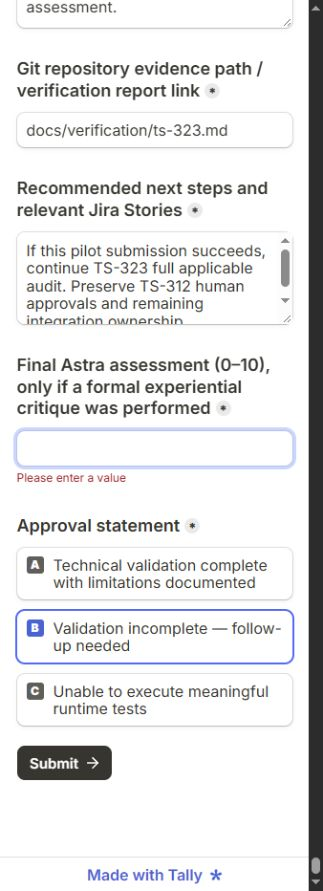

# TS-323 — Astra questionnaire pilot and local evidence report

Story: [TS-323](https://jonathangenier.atlassian.net/browse/TS-323). Parent: [TS-324](https://jonathangenier.atlassian.net/browse/TS-324). Branch: `ts-323-pg`. Run: `TS-323-2026-10-31-pilot`, 2026-10-31, America/New_York. Executed by 6 Astra, matching the recommended model; no independent second reviewer was used.

## Outcome

**Five-question pilot: FAILED at submission.** Opening, reading and answering Tally worked. All **14 sections**, **140 distinct questions A001–A140**, and **140 instances of each PASS / FAIL / PARTIAL / NOT TESTED choice** were observed. The five tested questions passed under the documented conditions; their selections were verified in Tally. The other 135 questions were explicitly selected NOT TESTED for the pilot.

**Tally submission: unconfirmed; blocked by client-side validation.** The form remained on its editable questionnaire with `Please enter a value` beneath **“Final Astra assessment (0–10), only if a formal experiential critique was performed.”** No thank-you page, submission ID, receipt or other success confirmation appeared. This field requires a numeric score despite its conditional wording. The pilot precedes final verification and formal critique; supplying a made-up final rating would be misleading.

**Full audit: not started because the pilot submission gate failed.** Pilot coverage totals are **5 PASS / 0 FAIL / 0 PARTIAL / 135 NOT TESTED**. These are not a completed comprehensive audit. See the [complete question table](ts-323-evidence/questionnaire.md) and [structured per-question results](ts-323-evidence/results.json), including actual question text, conditions, observations, evidence and limitations.

No gameplay fixes, architecture changes, version changes, configuration edits or Jira writes were made. Only this report, its evidence and the historical verification index are delivery changes.

## Tally interaction evidence

Published form: <https://tally.so/r/ArzBOB>.

1. Opened the form in the in-app browser and entered the pilot run identity, tested source SHA, date and limitations.
2. Advanced from the run-information page to the questionnaire. Read and preserved the accessible inventory; all 140 questions are on the second page, with 14 section headings and final summary fields.
3. Ran the existing startup, menu/session and death/respawn checks below. Selected A001–A005 PASS and A006–A140 NOT TESTED, with truthful evidence and pilot-only scope notes. Verified exactly 5 selected PASS and 135 selected NOT TESTED radios.
4. First Submit attempt exposed mandatory evidence/links fields for all remaining sections and the final critique field. Filled the untested sections with explicit NOT TESTED/no-evidence notes rather than invented logs.
5. Tried `N/A — five-question pilot; formal critique not yet performed.` for the conditional critique field. Although its HTML input type is text, the form filtered the value to `-.` and continued to reject it. Second Submit attempt still displayed the required-value error.
6. Cleared that invalid value and made a third Submit attempt. The only remaining `Please enter a value` error was the final critique field. Preserved the filled form for human follow-up; no response is claimed to have reached Tally. The later local operational critique below was not backfilled to turn this pilot into a different submission.

Evidence: [initial inventory](ts-323-evidence/tally-inventory.txt), [filled responses](ts-323-evidence/tally-pilot-filled.txt), [final blocked state](ts-323-evidence/tally-pilot-submit-result.txt), [blocker screenshot](ts-323-evidence/tally-submission-blocked.jpg).

## Tested source and prerequisites

- Source/base: `30bb34da24290f4ee4bfa3f7deeda232d88479b4`. Local main, origin/main and the initial Story HEAD matched after a fresh fetch. Working tree was initially clean.
- Actual codebase version: **0.2.75**; 0.3.0 is the Jira milestone label. No release/version claim was inferred from the questionnaire title.
- Windows **10.0.19045**, .NET SDK **10.0.401**, pinned Godot .NET **4.7.2.stable.mono.official.ed1daf0bf**. Rendered startup used Compatibility/OpenGL 3.3, NVIDIA 582.66, GTX 1070. [Environment record](ts-323-evidence/environment.json).
- Read root and Client AGENTS routing; workflow, verification, delivery, standards and critique; feature index; startup, main menu, game menu, match entry, death/respawn and networking integration guidance; EOS setup and third-party registry. Inspected `SimulationBootstrap`, startup/menu/death verification implementations and their PowerShell runners before executing them.
- Read TS-323 and TS-324 in full; TS-323 has no children or comments. Inspected the 0.3.0 Jira inventory and read relevant TS-312 and TS-322 requirements and TS-322's human-approval comment, plus historical TS-322 evidence. Broad weapon-specific audit preparation/testing was gated off with the full audit.
- `tools/check-agent-environment.ps1` confirmed SDK and Godot versions. CPU/GPU CIM inventory was denied in the sandbox; GPU identity above comes from the current renderer log, and CPU hardware was not re-established in this run.

## Five tested questions

| ID | Result | Observed behavior and evidence | Limits |
| --- | --- | --- | --- |
| A001 | PASS | Rendered production startup harness completed phase-aware recovery, initialization, input gating and persistent media continuity with exit 0 and no diagnostics. [Log](ts-323-evidence/startup-visual.log) | Verification switch disables EOS authentication and intentionally injects recoverable startup failures. Ordinary authenticated/exported startup was not tested. |
| A002 | PASS | Inspected the fresh 1280×720 settled menu capture: readable Play, disabled Garage/Coming Soon, Settings, Quit and v0.2.75. Harness checks navigation, stable targets and layout bounds at 640×360, 1280×720 and 1600×900. [Capture](ts-323-evidence/menu-settled.png) | Direct screenshot-tool capture timed out; the inspected image was generated by the running native harness. Audible output and subjective motion quality were not assessed. |
| A003 | PASS | Native menu harness passed **3,535 assertions**, including new solo UDP session initialization and synchronized Countdown. [Log](ts-323-evidence/menu-native.log) | Automated native input and local session; no human/controller or WAN acceptance. |
| A004 | PASS | Same run verified Leave → Main Menu, reentry → fresh Countdown and production Quit/session/arena cleanup. [Log](ts-323-evidence/menu-native.log) | Tested lifecycle paths only; not a long-session leak proof. |
| A005 | PASS | Eight native UDP peers completed four alternating Missile/collision death/respawn cycles. All peers observed Dead/Respawning/Alive; respawn ticks **465/662/961/1158**; physics, HP, items and VFX reset; discarded second slot stayed discarded. [Log](ts-323-evidence/death-native.log), [cycle evidence](ts-323-evidence/death-evidence.txt) | Eight peers in one process with separate native worlds, not eight independent clients/devices. No impairment switch, water or out-of-bounds variant in this pilot. |

## Commands and results

Executed from the repository root. `$godot` resolves to `.godot/godot-ci/4.7.2/Godot_v4.7.2-stable_mono_win64/Godot_v4.7.2-stable_mono_win64_console.exe`.

| Actual command | Result / evidence |
| --- | --- |
| `git fetch origin`; `git rev-list --left-right --count HEAD...origin/main` | Fetch retried with filesystem permission; **0 / 0** before testing. |
| `./tools/check-agent-environment.ps1 -GodotPath $godot -Json` | SDK/Godot launch-version checks PASS; explicitly not gameplay verification. |
| `dotnet build Trackstorm.sln -c Debug -warnaserror -m:1 -nr:false` | Initial build and permission retry failed **NU1900** querying NuGet vulnerability data. [Initial](ts-323-evidence/build.log), [retry](ts-323-evidence/build-network.log). |
| `dotnet restore Trackstorm.sln --force --no-cache` | Native/network-permission retry **PASS**, auditing left enabled. [Log](ts-323-evidence/restore-network.log). |
| `dotnet build Trackstorm.sln -c Debug --no-restore -warnaserror -m:1 -nr:false` | **PASS**, zero warnings/errors. [Log](ts-323-evidence/build-final.log). |
| `./check-startup.ps1 -GodotPath $godot -SkipBuild` | Scenario success marker, but wrapper **FAIL** due sandbox user-log and certificate-store errors. [Log](ts-323-evidence/startup.log). |
| `./check-menu.ps1 -GodotPath $godot -NoBuild` (sandbox) | 3,535 assertions passed, but wrapper **FAIL** for the same environmental diagnostics. [Log](ts-323-evidence/menu.log). |
| `./check-death-respawn.ps1 -GodotPath $godot -NoBuild` (sandbox) | Four cycles passed, but wrapper **FAIL** for the same environmental diagnostics. [Log](ts-323-evidence/death.log). |
| `./check-startup.ps1 -GodotPath $godot -SkipBuild -Visual` (native permissions) | **PASS**, five frontend media files verified, exit 0, success marker, no ERROR/WARNING diagnostics. [Log](ts-323-evidence/startup-visual.log). |
| `./check-menu.ps1 -GodotPath $godot -NoBuild` (native permissions) | **PASS**, 3,535 assertions, wrapper exit 0, about 25.18 seconds. [Log](ts-323-evidence/menu-native.log). |
| `./check-death-respawn.ps1 -GodotPath $godot -NoBuild` (native permissions) | **PASS**, four eight-peer cycles, wrapper exit 0, about 58.96 seconds. [Log](ts-323-evidence/death-native.log). |
| `./check.ps1` (native/network permissions) | **PASS**, exit 0: workflow/version/media helper regressions, all five media files, restore, Debug production and Release solution builds with zero warnings/errors, **1,520 Core tests + 507 non-native transport/Client tests**, zero failed/skipped. [Log](ts-323-evidence/check.log). Expected negative-test diagnostics inside helper regressions are not gate failures. |
| `./tools/check-version.ps1` | **FAIL**, expected **0.2.76**, actual/main **0.2.75**. [Log](ts-323-evidence/version-check.log). Kept version/configuration unchanged under the explicit documentation/evidence-only scope. This is an outstanding normal Story delivery gate, not a gameplay failure. |

The visual startup run overlapped the first sandbox death run; subsequent native menu/death runs were sequential. The menu screenshot's instantaneous FPS is not a benchmark. No reboot, background-load controls or performance comparison was performed. Sandbox failures are retained, not erased or reclassified as successful wrapper runs. No security or package-audit settings were weakened.

## Findings and preserved approvals

**Confirmed questionnaire defect:** the conditional final critique field is unconditionally required and numeric, blocking an honest pilot before formal critique. The remaining sections' evidence fields also require text even when their questions are NOT TESTED; explicit no-evidence notes satisfy those fields. Recommendation for TS-323/TS-324 owner approval: make final critique optional or condition it on a completed formal review, and support a clearly identified pilot submission. No form design or Jira issue was changed.

**No new gameplay defect established** in the five tested scenarios. Environmental NuGet and native-access errors were resolved by ordinary permission/cache retries, without modifying game code. The version gate remains explicitly unsatisfied.

TS-312 records TS-303–307 as individually implemented, verified and human-approved; these approvals remain intact. Its real multiplayer, physical mouse/controller, latency and sustained all-weapons audit remains pending. TS-322's 2026-10-31 human comment accepts its 7.0/10 review and qualitative editor playtest (roughly 50–70 FPS under load, intermittent ~10 FPS drops) with no more polish. Those historical approvals are preserved; they do not establish a new controlled performance result here. Original weapon/feature integration Stories keep their ownership and acceptance requirements.

All A006–A140 remain NOT TESTED as questionnaire audit items. Some supporting menu/death assertions incidentally exercise related behavior; they were not promoted to a full question verdict after the failed pilot. Remaining coverage includes settings/HUD in full practical play, driving/physics/camera/aim feel, every weapon's integrated behavior and presentation/audio, controlled performance, long-session stability, and independent multiplayer. Automated loopback checks do not replace developer/player multiplayer approval.

## Astra Runtime Critique — Story Round 1

**Overall Score: 6.0 / 10. Quality Assessment: BELOW TARGET (<8.0).** This is a limited operational critique of the TS-323 pilot and submission workflow, performed after final verification. It is **not a comprehensive game-quality or 0.3.0 release score**, and is not a claim that the full Story audit was executed.

| Category | Score | Basis |
| --- | --- | --- |
| Runtime Functionality (pilot scenarios only) | 8.0 / 10 | Startup recovery and menu operation, session initialization/cleanup/reentry, and four eight-peer death/respawn cycles succeeded under the recorded conditions. |
| UI / UX (questionnaire operation) | 6.0 / 10 | All sections/questions readable and answers retained; substantial required boilerplate even for untested sections, and conditional wording conflicts with required numeric input. |
| Feature-Specific Operational Quality | 4.0 / 10 | The central pilot response workflow cannot complete honestly before the final critique. Local evidence remains usable, but Tally submission is unconfirmed. |

**What Was Exercised:** VERIFIED — real browser reading/filling and three Submit attempts, current native rendered startup and screenshot inspection, native menu and eight-peer lifecycle checks. INFERRED — making the critique field optional/conditional should permit the pilot to advance; server acceptance still needs an actual successful retry. UNVERIFIED — server-side receipt, full 140-question audit, physical controls/game feel/audio, long-session performance and human multiplayer. Build/unit-test counts are supporting verification, not substitutes for experiential observations. Direct window screenshot capture timed out; game visual judgment is limited to the native harness's saved menu image.

**Problem:** a mandatory numeric final-review field blocks the pilot before that review is due. **Evidence:** the [final browser state](ts-323-evidence/tally-pilot-submit-result.txt) and [screenshot](ts-323-evidence/tally-submission-blocked.jpg); no confirmation after three attempts. **Severity: High** for this Story's submission objective. **Impact:** validated pilot evidence cannot be submitted without prematurely inventing a final score. **Suggested Improvement:** have the form owner make the critique field optional or conditional on a completed critique, or provide a pilot mode that accepts N/A. **Scope:** In Scope as a reported TS-323/TS-324 workflow issue; changing form configuration was not performed. **Corrective Work Type: No Code Change Required.**

**Recommended Next Round:** after human direction and form correction, retry the saved five-question pilot with truthful evidence and confirm a receipt before starting the full audit. Then perform the remaining supported runtime checks, retaining NOT TESTED for unavailable conditions and separate developer/player multiplayer signoff. No gameplay polish or follow-up Jira creation was performed.

## Delivery

The report and evidence are the only intended changes. The normal automatic PR workflow triggers on a `ts-*` push, so this documentation-only delivery uses `[skip ci]` in the commit message to honor the explicit instruction not to create a PR. GitHub documents this [push-workflow skip behavior](https://docs.github.com/en/actions/how-tos/manage-workflow-runs/skip-workflow-runs). No CI result is claimed from the skipped push; local verification is recorded independently. No merge, corrective implementation, new Jira task or additional polish round is authorized by this report.
